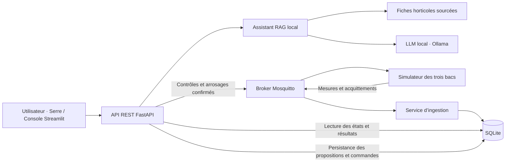

# GreenMind 🌱

**Une serre connectée virtuelle associant simulation du réel, pilotage IoT et assistant horticole local.**

GreenMind simule trois bacs indépendants — **basilic, thym et romarin** — soumis à une même journée météo synthétique. Chaque espèce possède son profil de dessèchement, ses seuils d’alerte et son arroseur virtuel. L’utilisateur peut faire évoluer la simulation, provoquer une sécheresse et confirmer un arrosage dont il suit ensuite l’exécution.

GreenMind est un **projet de fin de formation Architecte AIoT chez Technofutur TIC**. Il propose une simulation simplifiée d’une serre réelle : météo, évolution de l’humidité du sol et arrosage sont modélisés, tandis que les échanges MQTT, la persistance, le pilotage et les acquittements empruntent une véritable chaîne applicative. Les capteurs et actionneurs sont virtuels.

## Fonctionnalités

- Une journée de 24 heures, avec une météo variable commune aux trois bacs.
- Pause, reprise, avance d’une heure virtuelle et injection d’humidité sur un bac.
- Transport MQTT réel via Mosquitto, contrats JSON stricts et stockage SQLite.
- Alertes de sécheresse persistantes, réarmement et journal filtrable par bac.
- API REST FastAPI pour consulter et piloter la serre.
- Arrosage en deux étapes : **proposition → confirmation → commande MQTT → acquittement → mesure après effet**.
- Protection contre les doublons, anciennes sessions, révisions périmées et commandes concurrentes ; repos d’arrosage par bac et suivi des exécutions incertaines.

- Deux vues Streamlit : suivi de la serre et console de contrôle de la simulation.
- Assistant horticole local fondé sur un RAG : réponses contextualisées par les mesures du bac et trois fiches Markdown sourcées, avec références aux sections utilisées.
- Séparation entre explication et action : l’assistant ne déclenche aucun arrosage ; la confirmation reste une décision utilisateur.
- Lancement, arrêt et réinitialisation contrôlés pour rejouer les scénarios.

## Architecture



Les échanges MQTT utilisent le schéma **v3** et les topics `greenmind/v3/...`. L’API utilise le préfixe **`/api/v1`** : sa version est indépendante de celle du contrat MQTT.

## Installation

### Prérequis

- **Python 3.12**.
- **Docker avec Docker Compose**, pour le broker Mosquitto.
- Un environnement Unix ; le projet est développé et vérifié sur **macOS Apple Silicon**. Le verrou du simulateur utilise `fcntl`, indisponible nativement sous Windows.

Depuis le dossier qui contiendra le projet :

```bash
git clone https://github.com/jeanb1970/GreenMind.git
cd GreenMind
python3.12 -m venv .venv
source .venv/bin/activate
source scripts/runtime_env.sh
python -m pip install -r requirements.lock.txt
```

La partie IA repose sur Ollama pour la génération locale, MiniLM pour les représentations vectorielles et FAISS pour la recherche documentaire. Les modèles, les dépendances, le corpus et l’image Docker sont préparés avant une utilisation hors ligne. La chaîne IoT reste utilisable indépendamment du service de génération.

## Essayer la simulation sans broker

Ces commandes n’écrivent pas en base et ne publient rien sur MQTT :

```bash
PYTHONPATH=src .venv/bin/python scripts/check_greenhouse.py
PYTHONPATH=src .venv/bin/python scripts/check_simulation_day.py
```

Pour piloter la journée au clavier :

```bash
PYTHONPATH=src .venv/bin/python scripts/check_simulation_day.py --interactive
```

Commandes disponibles : `etat`, `heure`, `lecture`, `humidite thym 18` et `quitter`. Pendant la lecture, `Ctrl+C` met en pause.

## Lancer la chaîne MQTT et l’API

Démarrer Docker, puis le broker depuis la racine du dépôt :

```bash
docker compose up -d mosquitto
```

Ouvrir **trois terminaux**, chacun dans le dossier du projet. Dans chaque terminal, préparer l’environnement :

```bash
source .venv/bin/activate
source scripts/runtime_env.sh
export PYTHONPATH=src
```

Lancer ensuite les services **dans cet ordre** :

| Terminal | Commande | Avant de continuer |
|---|---|---|
| 1 | `python -m greenmind.ingestion.main` | Attendre le message `Ingestion prête` |
| 2 | `python -m greenmind.simulator.main` | Attendre le message `Simulateur prêt en pause` |
| 3 | `python -m greenmind.api.main` | Attendre le démarrage du serveur HTTP |

La serre démarre **en pause au pas 0**. En lecture, une heure virtuelle s’écoule toutes les cinq secondes réelles. Au pas 24, la simulation s’arrête en pause.

- Documentation interactive : [http://127.0.0.1:8000/docs](http://127.0.0.1:8000/docs)
- Santé des services : [http://127.0.0.1:8000/api/v1/health](http://127.0.0.1:8000/api/v1/health)
- État des trois bacs : [http://127.0.0.1:8000/api/v1/plants](http://127.0.0.1:8000/api/v1/plants)

Pour arrêter : `Ctrl+C` dans les trois terminaux, puis `docker compose stop mosquitto`. Pour rejouer la journée, relancer le simulateur après son arrêt : il crée une nouvelle session. Les données des anciennes sessions restent dans SQLite ; les vues courantes de l’API sélectionnent la plus récente.

### Configuration

Les profils et les coefficients sont définis dans [`config/greenhouse.yaml`](config/greenhouse.yaml). La météo simulée est décrite dans [`data/readme.md`](data/readme.md).

| Variable | Valeur par défaut | Usage |
|---|---|---|
| `GREENMIND_MQTT_HOST` | `127.0.0.1` | Adresse du broker |
| `GREENMIND_MQTT_PORT` | `1883` | Port du broker |
| `GREENMIND_DATABASE_PATH` | `outputs/greenmind.sqlite` | Base utilisée par l’ingestion et l’API |
| `GREENMIND_API_HOST` | `127.0.0.1` | Adresse d’écoute HTTP |
| `GREENMIND_API_PORT` | `8000` | Port HTTP |

Appliquer les mêmes paramètres MQTT aux trois services et le même chemin de base à l’ingestion et à l’API. Le broker fourni est lié à l’interface locale ; l’application locale ne fournit pas d’authentification applicative.

## Utiliser l’API

La page `/docs` permet d’exécuter les requêtes et d’inspecter leurs schémas.

| Route sous `/api/v1` | Fonction |
|---|---|
| `GET /plants` et `GET /plants/{plant_id}` | État, profil et alerte d’un bac |
| `GET /plants/{plant_id}/measurements` | Mesures récentes |
| `GET /events?plant_id=thym` | Journal filtré ; au plus 100 événements |
| `GET /simulation` | Session, horloge et révision courante |
| `POST /simulation/controls` | `pause`, `reprendre`, `avancer_1_heure`, `modifier_humidite_sol` |
| `GET /simulation/controls/{control_id}` | Résultat d’un contrôle |
| `POST /plants/{plant_id}/watering-proposals` | Proposition déterministe sans effet sur la serre |
| `POST /plants/{plant_id}/watering-commands` | Confirmation d’une proposition |
| `GET /watering-commands/{command_id}` | Suivi de l’arrosage et attente éventuelle de sa mesure |

Pour simuler une sécheresse : lire la révision dans `/simulation`, puis envoyer un contrôle `modifier_humidite_sol` sur `thym` avec `moist_request_pct: 18.0` et cette `expected_state`. Attendre son résultat `appliqué`, demander une proposition d’arrosage avec un corps `{}`, puis confirmer son `proposal_id`. L’injection nécessite une simulation en pause.

### Identifiants et confirmation d’effet

- **`simulation`** distingue chaque démarrage, par exemple `Simu_001 du 28 Oct. 2026 à 14:30` ; son compteur est persistant.
- **`control_id` / `command_id`** identifient une demande : conserver la même clé lors d’une nouvelle tentative. Une clé réutilisée avec un autre contenu est refusée.
- **`event_id`** (`Evenement_000001`) permet à SQLite de dédoublonner les mesures et événements reçus. Les autres clés suivent les formats `Controle_000001`, `Arrosage_000001`, `Proposition_000001` et `Alerte_000001`.

Une réponse HTTP **202** ou un **PUBACK MQTT** confirme la prise en charge ou le transport, pas l’effet de l’arrosage. Son état devient `exécuté` uniquement après l’acquittement métier. Sans acquittement dans les dix secondes, le suivi indique `TIMED_OUT` : l’exécution reste incertaine, les nouvelles mutations sont bloquées et aucun renvoi automatique n’est effectué. Un acquittement tardif peut résoudre cette incertitude.

Une proposition expire après 60 secondes réelles. Après un arrosage, le bac doit respecter son repos de 60 secondes réelles. Ces délais sont indépendants de l’heure virtuelle.

## Vérification

La suite automatisée ne nécessite pas de broker actif :

```bash
.venv/bin/python -m pytest tests -q
```

Pour les recettes avec le **vrai broker**, démarrer Mosquitto et arrêter préalablement les services Python manuels, puis lancer les scripts **l’un après l’autre** :

```bash
PYTHONPATH=src .venv/bin/python scripts/check_mqtt_pipeline.py
PYTHONPATH=src .venv/bin/python scripts/check_api.py
PYTHONPATH=src .venv/bin/python scripts/check_watering.py
```

Chaque recette démarre ses propres services avec une base temporaire et les arrête ensuite. Une seule instance du simulateur peut détenir le verrou du projet. La recette d’arrosage couvre les trois bacs, les doublons, le repos, le timeout et un acquittement tardif.

Les bases, journaux et index générés se trouvent dans `outputs/`, ignoré par Git. Une base utilisant les anciens champs doit être reconstruite avant le démarrage, selon la procédure ci-dessous.

## Organisation du dépôt

```text
config/                 Profils des trois bacs
data/fixtures/          Journée météo synthétique
docs/                   Cahier des charges, plan et contrats
src/greenmind/
  domain/               Calculs de dessèchement, alertes et arrosage
  simulator/            Horloge, états et traitement des commandes MQTT
  ingestion/            Validation des messages et persistance
  db/                   Modèles SQLite et transactions
  api/                  API REST et publication des commandes
  dashboard/            Vues Serre et Console
scripts/                Contrôles locaux, recettes MQTT et essais IA
tests/                  Tests automatisés
```

## Documentation

- [Cahier des charges v1.4](docs/Cahier_des_Charges_v1.4_Serre.md)
- [Contrats MQTT, API et arrosage](docs/contracts.md)
- [Données et conventions de simulation](data/readme.md)

## Interface et gestion des sessions

Depuis la racine du projet, avec Docker démarré :

```bash
.venv/bin/python scripts/demo.py start
.venv/bin/python scripts/demo.py stop
.venv/bin/python scripts/demo.py reset
```

`start` lance Mosquitto puis ingestion, simulateur, API et Streamlit dans l’ordre.
Ouvrir http://127.0.0.1:8501. Le menu propose Serre et Console ; utiliser
**Actualiser** pour relire les états et acquittements. `stop` arrête uniquement
les processus Python enregistrés par ce lanceur ; Mosquitto reste disponible.
`reset` arrête ces processus puis les relance avec une nouvelle session, en
conservant l’historique SQLite. Les journaux se trouvent dans `outputs/demo/`.
Arrêter les services lancés manuellement avant d’utiliser le lanceur.


## Formats et reconstruction de la base

Les contrats MQTT utilisent `schema_version: 3` et le préfixe `greenmind/v3`.
Les dates sont en heure belge (`Europe/Brussels`) : `2026-07-10 12:15:10` pour
l’heure météo/virtuelle, `2026-07-10 12:15:10.12345` pour les instants précis.

Les compteurs sont conservés séparément dans `outputs/identifiers.sqlite`.
Tous les processus doivent utiliser le même `GREENMIND_IDENTIFIERS_PATH` si
ce chemin est personnalisé. Ils ne sont réinitialisés ni par un reset de session,
ni par la reconstruction de la base de serre. Un client peut réserver une clé via
`POST /api/v1/identifiers/control`, `/proposal` ou `/command`, avec un corps `{}`,
puis conserver cette clé pour ses tentatives de la même demande. Sinon, l’API
alloue une clé lorsqu’elle crée une nouvelle demande sans identifiant fourni.

Après arrêt des services, reconstruire explicitement la base si elle utilise
l’ancien schéma (cette commande efface son historique, sans sauvegarde) :

```bash
.venv/bin/python scripts/demo.py stop
PYTHONPATH=src .venv/bin/python scripts/reset_database.py
```

Pour une base distincte, passer `--database /chemin/vers/base.sqlite`.
Le dictionnaire complet est dans [les noms et formats validés](docs/Nommage_champs_valide.md).
