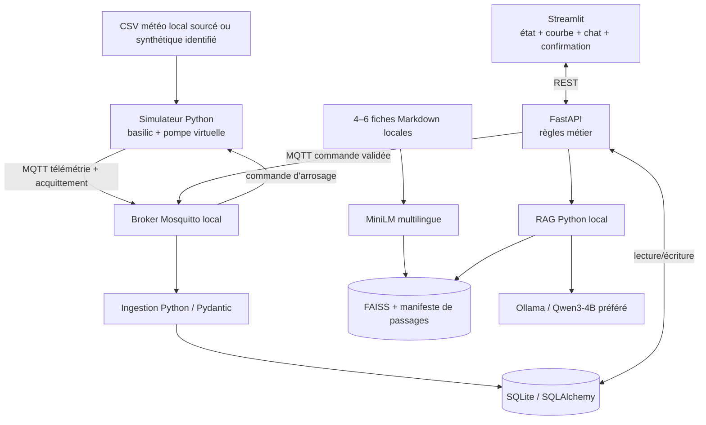

# GREENMIND — Cahier des charges fonctionnel et technique

**Version 1.3 — MVP de soutenance, contrats techniques et orchestration précisés**  
**Date :** 22 octobre 2026  
**Projet :** jardin connecté simulé avec assistant horticole RAG local  
**Contexte :** projet pédagogique de fin de formation « Architecte IA/IoT : Développeur Python Intelligence Artificielle », Technofutur TIC  
**Nature :** preuve de concept (PoC) AIoT, sans capteurs ni actionneurs physiques  
**Développeur :** une personne, assistée d'outils IA (ChatGPT, Gemini, etc.)  
**Matériel cible :** MacBook Apple M3, 16 Go de mémoire unifiée  
**Durée non extensible :** **8 journées**, soit **J1–J6 pour développement, intégration et tests**, puis **J7–J8 exclusivement pour la soutenance**  
**Statut :** spécification de référence proposée ; acceptation du sujet par le formateur/jury à confirmer avant J1.

> **Décision v1.3 :** démontrer une **seule plante virtuelle (basilic)**, avec la vraie circulation des événements entre simulateur, MQTT, base de données, API et interface ; une **alerte déterministe**, un **assistant RAG local sourcé**, puis une **commande d'arrosage explicitement confirmée et acquittée par MQTT**. Le projet n'entraîne aucun modèle, n'utilise pas MCP et ne dépend d'aucune API d'IA distante à l'exécution.

> **Principe contractuel :** le MVP livré doit être un système de bout en bout réellement opérationnel. Une simulation cohérente sur une plante, correctement testée, prime sur trois plantes partiellement intégrées. Les seules fonctionnalités marquées **MUST** sont nécessaires à l'acceptation ; les autres sont des extensions sans engagement de livraison.

---

## 0. Historique et arbitrages (v1.1 → v1.2 → v1.3)

| Domaine | v1.1 | Socle conservé de v1.2 | Motif |
|---|---|---|---|
| Période de travail | 8 jours de réalisation annoncés | **6 jours de réalisation + 2 jours de soutenance** | Temps réellement disponible |
| Plantes | 3 plantes dans le MUST | **1 basilic dans le MUST** ; autres facultatives | Réduire l'intégration et les tests |
| Météo | Historique Open-Meteo de 30 jours, préparation et replay | **Petit CSV local figé** ; historique sourcé si disponible, valeurs synthétiques de secours dûment signalées | Rendre la démo reproductible et autonome |
| RAG | 10–20 documents Markdown/PDF | **4–6 fiches Markdown courtes et sourcées**, centrées sur le basilic/arrosage | Éviter le coût d'extraction et de vérification |
| Vectorisation | MiniLM + FAISS, métadonnées SQL | **MiniLM + FAISS** ; correspondance avec les sources dans un manifeste local versionné | Éviter un couplage SQL supplémentaire non essentiel |
| Interface | Plusieurs écrans obligatoires | **Une application Streamlit simple** avec zones/onglets | Réduire le code d'interface |
| API | Une dizaine de routes | **7 routes utiles au parcours** | Diminuer la surface d'intégration |
| Test de recette | 10 unitaires, 11 intégration, 10 questions RAG | **8 scénarios automatisés prioritaires + 5 questions manuelles** | Aligner recette et temps disponible |
| Reset | Souhaitable | **Obligatoire pour la démonstration** | Permettre plusieurs répétitions |
| Plan de repli | Indicatif | **Jalons quotidiens, seuils de décision et replis autorisés** | Contenir les aléas |
| Séparation IA/commande | Obligatoire | **Inchangée** | Exigence fondamentale de sécurité |
| Hors ligne et sans entraînement | Obligatoires | **Inchangés** | Exigences structurantes |

### 0.1. Changements ciblés apportés par la v1.3

| Sujet | Décision nouvelle ou clarifiée | Valeur de la décision |
|---|---|---|
| Mosquitto 2.x | Configuration explicite `docker/mosquitto.conf` ; exposition de Docker **uniquement** sur `127.0.0.1:1883` | Évite les connexions refusées et l'exposition réseau involontaire |
| Client MQTT de l'API | Une connexion Paho dédiée et réutilisée, initialisée/fermée via `FastAPI(lifespan=...)`, disponible dans `app.state.mqtt_client` | Pas de connexion MQTT par requête HTTP |
| Ollama | `httpx.AsyncClient` partagé via `lifespan` ; appel local **non streamé** à `/api/generate`, timeouts bornés | Mode d'accès explicite et gestion des erreurs |
| Quatre processus Python | `start_local.sh` supervise le simulateur, l'ingestion, FastAPI et Streamlit ; `stop_local.sh` arrête **uniquement** les processus identifiés | Démarrage et arrêt reproductibles |
| Reset | `reset_demo.py` ne modifie la base qu'après arrêt confirmé des processus et remise à zéro contrôlée du broker | Évite verrous SQLite et événements résiduels |
| Tests | Les **8 scénarios** et **9 critères GO/NO-GO** restent en nombre inchangé, mais couvrent explicitement le lancement, l'arrêt et le redémarrage | Aucun gonflement fonctionnel |
| Planning | Ajout de points de contrôle de connexion/supervision J1–J3 et des tests d'arrêt/reprise J6 | Conserve strictement 6 jours de réalisation + 2 de soutenance |

**Corrections apportées à l'analyse externe :** sans listener configuré, Mosquitto 2.x peut accepter les connexions anonymes *depuis la boucle locale du même environnement* ; le problème spécifique de Docker est l'accès du Mac à un listener ne restant pas dans le seul loopback du conteneur. `persistence false` désactive la sauvegarde disque de l'état du broker, **mais n'efface pas à lui seul les retained messages vivants en mémoire**. Enfin, un PID est un identifiant à vérifier, pas une autorisation de tuer n'importe quel processus.


**Lecture des priorités :**
- **MUST** : condition de recette du MVP ; ne peut être abandonnée sans changer officiellement l'objectif de la soutenance.
- **SHOULD** : fonctionnalité à envisager seulement si les critères MUST sont déjà satisfaits.
- **COULD** : perspective d'évolution, non planifiée sur ces huit jours.
- **WON'T** : explicitement hors périmètre.

---

## 1. Synthèse, besoin et finalité

GreenMind est une application pédagogique de surveillance d'un pot de **basilic virtuel**. Elle simule périodiquement des mesures d'humidité du substrat et des conditions météorologiques rejouées, transmet les événements via MQTT, les stocke en base SQL, puis les affiche dans un dashboard. Lorsqu'un seuil configuré est franchi, une alerte apparaît.

Un assistant horticole local associe **les mesures connues** à un **petit corpus documentaire vérifié** grâce à un RAG (Retrieval-Augmented Generation). Il explique la situation en français et expose ses sources, sans inventer de données et sans décider d'une commande. Un moteur de règles distinct calcule si un arrosage virtuel peut être proposé. L'utilisateur confirme explicitement ; le simulateur reçoit la commande MQTT, modifie l'humidité et renvoie son **propre acquittement**.

### 1.1. Valeur métier et pédagogie

- Montrer le cycle **capteur simulé → message IoT → donnée persistée → lecture métier → recommandation IA → action supervisée → retour d'état**.
- Illustrer l'architecture modulaire Python, l'ORM, les API REST, MQTT, les tests automatisés, le RAG, le modèle pré-entraîné et la visualisation.
- Distinguer strictement **fait observé ou calculé**, **règle déterministe**, **extrait documentaire** et **génération LLM**.
- Présenter une approche argumentée de sécurité : le LLM explique mais n'actionne pas.

### 1.2. Point de recevabilité pédagogique à confirmer (bloquant administratif)

Le programme de formation fourni évoque une **« étude de cas d'une vraie entreprise »** devant jury. GreenMind est, à ce stade, un cas d'usage *simulé sans entreprise commanditaire*. **Demander expressément au formateur si cette démonstration simulée remplit les attentes d'évaluation.** Le présent cahier des charges ne présume pas de cette acceptation.

La solution couvre directement Python, SQLAlchemy, Pytest, API, IA générative/RAG, MQTT et dashboard ; elle ne prétend pas mettre en œuvre le ML supervisé, la vision artificielle, les capteurs physiques ni le Cloud IoT. La détection de sécheresse par seuil n'est **pas** une détection d'anomalie par apprentissage automatique.

---

## 2. Hypothèses et décisions de référence

| ID | Hypothèse / décision | Statut |
|---|---|---|
| H-01 | Exécution sur un seul MacBook M3, 16 Go ; une session utilisateur | MUST |
| H-02 | Une seule plante : `basilic_01`, paramètres issus de `config/plants.yaml` | MUST |
| H-03 | Aucun capteur, aucune pompe et aucune mesure de substrat physiques | MUST |
| H-04 | Météo issue d'un CSV local fixé ; provenance historique ou synthétique explicitement indiquée | MUST |
| H-05 | Humidité du substrat 100 % synthétique, évolution déterministe | MUST |
| H-06 | Broker local Mosquitto, simulateur et ingestion dans deux processus distincts | MUST |
| H-07 | FastAPI, SQLAlchemy/SQLite, Streamlit, Pytest et validation Pydantic | MUST |
| H-08 | Ollama natif macOS, modèle privilégié `qwen3:4b-instruct` quantifié Q4 ; benchmark J1 | MUST pour LLM local, modèle exact conditionné au test |
| H-09 | Embeddings `paraphrase-multilingual-MiniLM-L12-v2` + index FAISS par défaut | MUST pour recherche sémantique ; moteur substituable selon repli documenté |
| H-10 | 4–6 fiches Markdown locales, sourcées, sans PDF ni OCR dans le MVP | MUST |
| H-11 | Toutes les inférences, la recherche et les flux métier fonctionnent hors ligne après préparation | MUST |
| H-12 | Une réponse LLM ne peut ni fixer la durée d'arrosage ni publier une commande | MUST |
| H-13 | Les seuils d'humidité sont illustratifs, non des prescriptions agronomiques | MUST |
| H-14 | Versions logicielles figées après vérification effective sur le Mac | MUST |
| H-15 | Pas de MCP, fine-tuning, cloud ni API IA payante | MUST |
| H-16 | Extension à trois plantes uniquement lorsque les critères MUST sont atteints | SHOULD |
| H-17 | Fichier `docker/mosquitto.conf` monté explicitement ; port Docker lié à `127.0.0.1` côté Mac | MUST |
| H-18 | Paho MQTT Python callback API `VERSION2`, un client par processus, unique et réutilisé | MUST |
| H-19 | Client de publication MQTT créé dans le `lifespan` FastAPI ; un seul worker Uvicorn, sans auto-reload en démo | MUST |
| H-20 | Client Ollama HTTP partagé via `httpx.AsyncClient` ; timeouts explicites ; maximum une génération simultanée | MUST |
| H-21 | Cycle démarrer → contrôler → arrêter → reset → relancer, sans suppression de processus étrangers | MUST |
| H-22 | Les modèles et images Docker sont téléchargés et validés avant le test final hors ligne | MUST |

**Dimensionnement non garanti :** le volume de téléchargement du LLM n'est pas égal à son empreinte mémoire en exécution. RAM disponible, temps de génération et dépendances ARM64 seront **mesurés sur la machine réelle en J1** ; aucun débit ou délai non testé n'est promis.

---

## 3. Périmètre contractuel

### 3.1. MUST — contenu exact du MVP

| ID | Exigence | Résultat attendu |
|---|---|---|
| F-01 | Simuler `basilic_01` avec une météo locale et une humidité de substrat déterministe | Évolution visible et reproductible |
| F-02 | Publier la télémétrie en JSON via MQTT ; la consommer dans un service distinct | Messages visibles sur les topics définis |
| F-03 | Persister les mesures et événements essentiels dans SQLite via SQLAlchemy | Historique consultable ; dédoublonnage événementiel |
| F-04 | Déclencher une alerte de sécheresse par règle déterministe | Une alerte par épisode sous seuil |
| F-05 | Consulter mesures, alerte et commande via FastAPI | Contrat REST documenté par `/docs` |
| F-06 | Afficher un dashboard Streamlit simple avec dernières mesures, courbe, alerte, assistant et arrosage | Parcours complet depuis l'interface |
| F-07 | Rechercher des passages pertinents dans 4–6 fiches sourcées avec un index vectoriel local | Source réelle, traçable et visible |
| F-08 | Répondre via un LLM local en français, avec mesures fournies par l'application et extraits RAG | Pas de nombre ou de référence inventé accepté en recette |
| F-09 | Calculer une proposition d'arrosage par règles métier, confirmer côté utilisateur et revalider côté serveur | Aucune exécution issue directement du chat |
| F-10 | Publier la commande MQTT, recevoir un acquittement corrélé, puis afficher l'effet simulé | `EXECUTED` affiché uniquement après acquittement |
| F-11 | Fournir des fixtures et les scripts de démarrage, d’arrêt propre et de reset contrôlé | Plusieurs démonstrations consécutives possibles, sans processus orphelin |
| F-12 | Exécuter les tests prioritaires, documenter les limites et valider un parcours entièrement hors ligne | MVP vérifiable à J6 |

### 3.2. SHOULD — après MVP stabilisé uniquement

- Configurer la tomate et le romarin **sans multiplier les parcours spécifiques**.
- Ajouter des indicateurs de santé détaillés par service, un export CSV ou un réglage simple de vitesse de simulation.
- Ajouter des fiches et des questions RAG supplémentaires.
- Proposer une interface de reset si le script de reset obligatoire fonctionne déjà.

### 3.3. COULD — feuille de route post-soutenance

- Capteurs et pompe physiques ; règles de sécurité et calibration associées.
- Météo live, autres scénarios, suivi de consommation d'eau.
- Détection d'anomalies ML, prévision de dessèchement, évaluation RAG élargie.
- Authentification, déploiement réseau/cloud, supervision et sécurité de production.

### 3.4. WON'T — non prévu pendant les huit jours

MCP, agent autonome d'action, modèles entraînés, fine-tuning, Computer Vision, OCR, PDF dans le corpus initial, gestion multiutilisateur, application mobile, intégration de services IA distants, pilotage matériel réel et fonctionnalité agronomique certifiée.

---

## 4. Parcours de démonstration et critères métiers

1. **Voir le pot.** Le dashboard affiche `basilic_01`, la dernière humidité simulée, la température météorologique rejouée, leurs unités, leur origine et l'horodatage.
2. **Observer la sécheresse.** Un scénario initialisé par fixture fait franchir le seuil bas au basilic sans manipulation SQL ; le dashboard montre **une** alerte ouverte.
3. **Demander une explication.** L'utilisateur interroge l'assistant ; celui-ci reçoit une mesure réelle *au sens de l'application* (calculée par le simulateur et enregistrée en base), retrouve des fiches et affiche une réponse sourcée.
4. **Proposer une action.** Un bouton demande au moteur de règles une proposition déterministe ; l'écran affiche la durée, la justification et la demande de confirmation.
5. **Confirmer.** Un clic distinct déclenche l'envoi à l'API, qui revalide la mesure, les limites et l'absence de commande concurrente.
6. **Constater l'exécution.** La commande part via MQTT ; le simulateur la traite puis publie un acquittement. Le dashboard présente l'état `EXECUTED` **après** réception de l'événement, et la courbe montre l'augmentation simulée de l'humidité.
7. **Prouver une limite.** Une question sans source ou une commande invalide est refusée proprement ; l'IA ne peut pas contourner la confirmation.

**Préparation obligatoire :** un reset par script remet les données de démonstration dans un état connu avant chaque répétition.

---

## 5. Architecture cible réduite



**Frontières non négociables :**
- `simulator` : génère les mesures et exécute **virtuellement** les commandes ; n'écrit pas directement en SQL.
- `ingestion` : valide les événements entrants et enregistre mesures, alertes et accusés ; ne génère aucun texte libre.
- `api` : fournit les lectures, la proposition et la confirmation contrôlée, et relaie la commande MQTT.
- `rag` : récupère les passages et prépare une réponse **sans droit d'exécution**.
- `dashboard` : n'écrit ni dans SQLite ni directement sur MQTT ; échanges uniquement avec FastAPI.
- `ollama` : produit une explication, jamais un ordre MQTT ni une décision de sécurité.

**Exécution locale :** Ollama, Python, FastAPI, Streamlit, simulateur et ingestion en natif macOS ; Mosquitto via **Docker Compose comme chemin nominal**, installation native documentée comme repli si Docker échoue. Le projet fonctionne avec **un seul processus Uvicorn / un seul worker** (ni `--reload` ni `--workers` multiples pendant la démo) pour ne pas créer plusieurs clients MQTT, états de propositions ou tâches en arrière-plan.

**Responsabilité opérationnelle :** quatre processus *GreenMind* (simulateur, ingestion, API, interface) sont gérés par le lanceur ; Mosquitto (conteneur) et Ollama (service macOS) sont deux dépendances externes **dont le lancement/arrêt ne doit pas affecter d'autres projets**. Le README distingue explicitement « démarrer GreenMind » et « arrêter le service Ollama ».

---

### 5.1. Dépendances, ordre de démarrage et ports

| Service | Mode | Interface locale attendue | Précondition / santé |
|---|---|---|---|
| Mosquitto | Conteneur `greenmind-mosquitto` | MQTT `127.0.0.1:1883` côté Mac | Listener configuré ; publication puis réception d'un message-test réussies |
| Ollama | Service natif macOS | HTTP `http://127.0.0.1:11434` | Modèle local chargé et `/api/generate` accessible ; panne non bloquante pour l'IoT |
| Ingestion Python | Processus supervisé | Souscription MQTT | Connexion effective et abonnement confirmé avant démarrage du simulateur |
| FastAPI | Un processus Uvicorn | HTTP `http://127.0.0.1:8000` | API et SQLite disponibles ; connexion MQTT active ou état dégradé annoncé |
| Streamlit | Processus supervisé | HTTP `http://127.0.0.1:8501` | API consultable ; interface peut montrer un état dégradé |
| Simulateur Python | Processus supervisé | Publication/souscription MQTT | Ingestion déjà abonnée avant la première télémétrie |

**Ordre recommandé :** démarrer/vérifier Mosquitto → vérifier Ollama → démarrer ingestion et attendre abonnement actif → démarrer FastAPI et vérifier `/api/v1/health` → démarrer Streamlit → démarrer simulateur. Préparer un **timeout de démarrage** et une erreur lisible pour chaque étape ; ne jamais supposer qu'un processus prêt au niveau OS l'est déjà au niveau applicatif.

Les ports indiqués constituent des valeurs par défaut du MVP ; ils sont configurables dans `.env`, mais la version de démonstration utilise des valeurs gelées et documentées.


## 6. Données, provenance et simulation

### 6.1. Météo d'entrée

Un `data/fixtures/weather_sample.csv` local contient un petit ensemble de lignes (par exemple 24 à 72 pas horaires), suffisant pour la répétition de la démonstration. **La taille exacte importe moins que la reproductibilité.**

Colonnes minimales : `observed_at`, `air_temperature_c`, `air_humidity_pct`. Précipitations facultatives ; aucun téléchargement au runtime.

- Si les valeurs proviennent d'Open-Meteo, consigner l'URL/paramètres d'extraction, la date de récupération et les conditions d'attribution ; qualifier les valeurs de « météo historique rejouée ».
- Si l'on utilise une fixture **fabriquée** pour un repli, l'indiquer « météo synthétique de démonstration » ; **ne jamais la présenter comme un relevé Open-Meteo**.
- Le cahier ne fixe pas une ville de résidence : la localisation météo choisie pour l'exemple est une donnée configurable du scénario.

### 6.2. Humidité du substrat

Humidité exprimée en **% de l'échelle interne du simulateur**, sans équivalence établie avec la teneur volumique en eau d'un substrat réel.

```text
soil_next = clamp(soil_current - simulated_evaporation + simulated_irrigation, 0, 100)
```

- L'évaporation est fonction des paramètres de la plante et, de façon simple, des conditions météo d'entrée.
- Le gain d'humidité à l'arrosage dépend d'un coefficient configuré, non d'une performance réelle de pompe.
- La simulation doit être déterministe : mêmes fixtures et paramètres → mêmes valeurs.
- Scénario `demo_dry_basil` : état initial choisi pour atteindre le seuil d'alerte rapidement et de façon répétée.
- Une itération peut correspondre à **1 heure météo rejouée toutes les 5 secondes réelles**, valeur configurable ; les durées d'autorisation métier sont explicitement exprimées en temps **réel**, les durées de pompe en temps **virtuel**.

### 6.3. Profil unique obligatoire

| Plante | Identifiant | Seuil bas de simulation | Seuil haut de simulation | Statut |
|---|---|---:|---:|---|
| Basilic | `basilic_01` | 35 % | 65 % | Valeurs purement illustratives, configurables |

Source de référence des paramètres : **`config/plants.yaml`** au démarrage. SQLite conserve les événements, pas une deuxième copie mutable concurrente du profil pendant le MVP.

### 6.4. Horloges

- `observed_at` : heure **historique de la ligne météo**, ou origine du jeu synthétique si tel est le cas.
- `emitted_at` : heure UTC **réelle** d'émission de l'événement MQTT.
- `simulated_tick` : compteur incrémental d'itérations de simulation.
- Les graphiques de démonstration affichent de préférence `simulated_tick` et l'intitulé « Pas de simulation », afin de ne pas faire passer le replay pour des mesures actuelles.

---

## 7. Contrats MQTT minimaux

### 7.1. Topics

| Flux | Topic | QoS | Retain |
|---|---|---:|---|
| Mesures | `greenmind/v1/plants/{plant_id}/telemetry` | 1 | Non |
| Commandes | `greenmind/v1/plants/{plant_id}/commands` | 1 | **Non** |
| Acquittements | `greenmind/v1/plants/{plant_id}/events` | 1 | Non |

### 7.2. Télémétrie — exemple de schéma

```json
{
  "event_id": "3dd6b710-66f2-4243-8a24-725a03a22800",
  "schema_version": 1,
  "plant_id": "basilic_01",
  "observed_at": "2026-07-10T12:00:00Z",
  "emitted_at": "2026-10-21T14:00:00Z",
  "simulated_tick": 12,
  "air_temperature_c": 26.4,
  "air_humidity_pct": 48.0,
  "soil_moisture_sim_pct": 32.0,
  "pump_active": false,
  "provenance": "historical_weather_plus_synthetic_soil"
}
```

**Nota :** valeurs d'exemple de contrat uniquement. Si la météo de repli est synthétique, utiliser une autre valeur explicite de `provenance` (par exemple `synthetic_weather_plus_synthetic_soil`).

### 7.3. Commande et acquittement

Commande :

```json
{
  "command_id": "927f589b-d7d7-4ea0-b7d1-10145ad86e5a",
  "plant_id": "basilic_01",
  "action": "WATER",
  "duration_sim_s": 4,
  "requested_at": "2026-10-21T14:00:02Z"
}
```

Acquittement, émis **après** l'effet virtuel :

```json
{
  "event_id": "6ac57fb6-1245-4aa3-8ad2-39fc192b0197",
  "command_id": "927f589b-d7d7-4ea0-b7d1-10145ad86e5a",
  "plant_id": "basilic_01",
  "status": "EXECUTED",
  "executed_at": "2026-10-21T14:00:03Z",
  "soil_moisture_after_sim_pct": 48.0
}
```

Cycle minimal : `PENDING` → `SENT` → `EXECUTED` ou `REJECTED`/`TIMED_OUT`.

### 7.4. Garanties opérationnelles minimales

- Chaque événement a un `event_id` unique et chaque commande un `command_id` unique ; les doublons d'événements sont filtrés en SQL.
- Le simulateur mémorise les `command_id` déjà exécutés **pendant sa session** afin qu'un doublon MQTT ne provoque pas une deuxième irrigation.
- Les commandes ne sont **jamais retained** ; utiliser des sessions MQTT non persistantes pour le MVP ; **aucun renvoi automatique** sur timeout.
- Si l'acquittement tarde, afficher `TIMED_OUT` ou « exécution non confirmée » : ne pas déclarer l'arrosage exécuté. Un accusé tardif doit être corrélé et journalisé, sans nouvelle exécution.
- En cas de perte de connexion, afficher un état dégradé sans inventer de confirmation.
- **Limite assumée du PoC :** les protections de redémarrage et de commande persistante ne sont pas au niveau d'une pompe physique réelle. Toute réutilisation avec du matériel nécessiterait un journal d'idempotence durable et une sécurité matérielle.

---

### 7.5. Configuration Mosquitto 2.x — contrat opérationnel MUST

**Fichier nominal :** `docker/mosquitto.conf` :

```conf
# GreenMind : environnement pédagogique UNIQUEMENT local
listener 1883
allow_anonymous true
persistence false
log_dest stdout
```

**Fichier nominal :** `docker-compose.yml` :

```yaml
services:
  mosquitto:
    image: eclipse-mosquitto:2
    container_name: greenmind-mosquitto
    ports:
      - "127.0.0.1:1883:1883"
    volumes:
      - ./docker/mosquitto.conf:/mosquitto/config/mosquitto.conf:ro
    restart: "no"
```

**Choix de sécurité :** `allow_anonymous true` est toléré **uniquement** sur cette installation pédagogique liée au loopback hôte ; il n'est pas adapté à un broker partagé, réseau ou de production. `listener 1883` écoute sur les interfaces du **conteneur** ; c'est la publication Docker `127.0.0.1:1883:1883` qui limite l'accès depuis le Mac. Ne pas reprendre `1883:1883` sans IP hôte, qui expose potentiellement le port sur toutes les interfaces. La référence d'image `:2` désigne une famille majeure : verrouiller la version/digest réellement testé(e) en J1 avant la démonstration. Pas de `latest` pour la soutenance.

**Vérifications J1 :**

```bash
docker compose config
docker compose up -d mosquitto
docker compose ps
# Dans deux terminaux macOS (après installation des utilitaires clients) :
mosquitto_sub -h 127.0.0.1 -p 1883 -t greenmind/v1/test
mosquitto_pub -h 127.0.0.1 -p 1883 -t greenmind/v1/test -m "ping-v1.3"
```

**Persistance et reset :** la non-persistance évite d'écrire l'état MQTT dans une base broker sur disque, mais les messages retained pourraient encore exister **tant que le broker tourne**. GreenMind publie la télémétrie, les commandes et les acquittements avec `retain=False`; sessions clients non persistantes pour ce PoC. Pour remettre le broker à zéro, `docker compose restart mosquitto` (après arrêt des processus GreenMind) supprime son état en mémoire ; si des retained messages anciens sont présents dans un autre broker, le reset ne doit pas les supprimer aveuglément.

**Repli J1 :** installation native de Mosquitto avec un fichier de configuration local explicite et une seule instance contrôlée. Toujours tester une publication et une réception sur le même hôte. Aucun broker public.

### 7.6. Cycle de vie des clients MQTT Python

- **Bibliothèque retenue :** `paho-mqtt` avec `mqtt.Client(mqtt.CallbackAPIVersion.VERSION2, client_id=...)` et callbacks compatibles VERSION2.
- **Un client distinct** pour le simulateur, le consommateur d'ingestion et l'API (trois clients MQTT pour quatre processus GreenMind) ; identifiants clients distincts, stables dans une session.
- **Ingestion :** créer le client à son démarrage, attacher `on_connect`, `on_message` et `on_disconnect`, abonner à nouveau en `on_connect` après reconnexion ; appeler `loop_start()` une seule fois ou `loop_forever()` selon le processus, jamais les deux.
- **Simulateur :** souscrire aux commandes dans `on_connect`, publier la télémétrie selon l'horloge simulée, dédoublonner les `command_id`, émettre un ack après l'effet simulé.
- **API FastAPI :** créer la connexion MQTT **une seule fois** dans un gestionnaire `@asynccontextmanager lifespan`, conserver l'instance dans `app.state.mqtt_client`; `loop_start()` maintient la communication et les reconnexions sans recréer le client à chaque POST ; fermer proprement avec `disconnect()` puis `loop_stop()` à l'arrêt. Tous les paramètres de connexion viennent de la configuration.
- Avant l'envoi d'une commande, **vérifier la disponibilité du client**, le résultat de `publish(qos=1, retain=False)` et, lorsque nécessaire, l'acquittement MQTT du broker (PUBACK). Celui-ci confirme la livraison au broker, **pas** l'exécution de la pompe. Seul le message `EXECUTED` émis par le simulateur autorise l'état final.
- Ne pas bloquer la boucle `asyncio` de FastAPI en attendant Paho : si l'attente de publication est nécessaire, l'effectuer dans un thread dédié ou employer une intégration asynchrone contrôlée. La boucle Paho tourne de son côté.
- En panne de broker : commande refusée ou marquée comme non envoyée ; l'UI affiche un état dégradé et **aucun succès fictif**. Aucun ré-envoi automatique d'une commande dont l'exécution est incertaine.

**Exigence de recette :** deux POST successifs n'ouvrent pas deux connexions MQTT ; la fermeture de FastAPI libère sa connexion ; une reconnexion de l'ingestion rétablit sa souscription. Dans l'état `SENT`, la preuve se limite au broker ; seul un acquittement métier `EXECUTED` permet d'affirmer que l'action a été exécutée.


## 8. Règles métier déterministes

| ID | Règle MUST | Vérification |
|---|---|---|
| RM-01 | Absence de mesure ou mesure périmée : pas de nouvelle commande | Refus avec motif |
| RM-02 | Pompe active ou commande en cours : pas de nouvelle commande | Refus avec motif |
| RM-03 | Humidité supérieure ou égale au seuil haut : ne pas proposer d'arrosage | Refus ou proposition `eligible=false` |
| RM-04 | Humidité sous le seuil bas : ouvrir une alerte unique par épisode | Pas d'alerte dupliquée à chaque mesure |
| RM-05 | Proposition d'arrosage déterminée par `rules.py`, jamais par le LLM | Durée et motif structurés |
| RM-06 | Un clic de confirmation distinct de la proposition est nécessaire | Pas de commande au premier clic ni depuis le chat |
| RM-07 | Durée de pompe plafonnée à **10 secondes virtuelles** (illustratif) | Valeur excessive refusée |
| RM-08 | Un délai de repos de **60 secondes réelles** entre deux arrosages est appliqué (illustratif) | Commande rapprochée refusée |
| RM-09 | Identifiant de plante inconnu : commande rejetée | Pas de topic arbitraire |
| RM-10 | Une commande n'est déclarée exécutée qu'après acquittement du simulateur | Pas de succès par simple publication MQTT |

**Fraîcheur des mesures :** considérer la dernière mesure périmée au-delà de deux périodes réelles de publication plus une marge configurable ; comparer des horodatages UTC **réels**, pas l'heure météo historique.

**Clôture de l'alerte :** lorsque l'humidité simulée repasse au-dessus d'un seuil de réarmement configuré, l'alerte est close. Une alerte doit être représentée par un épisode ouvert/fermé, sans duplication incontrôlée.

---

## 9. RAG et assistant horticole local

### 9.1. Technologies de référence

| Fonction | Choix de référence |
|---|---|
| Génération | Ollama natif + `qwen3:4b-instruct` Q4, après benchmark J1 |
| Fenêtre de contexte | 4 096 tokens au démarrage ; aucun élargissement imposé |
| Embeddings | `sentence-transformers/paraphrase-multilingual-MiniLM-L12-v2` |
| Recherche vectorielle | FAISS `IndexFlatIP` avec vecteurs normalisés L2 |
| Métadonnées | Manifeste JSON/JSONL local : position, `chunk_id`, `doc_id`, titre, source, chemin, extrait et empreinte du corpus |
| Corpus | **4–6 fiches Markdown**, sans PDF ni OCR |
| Orchestration | Python direct, sans framework RAG obligatoire |

### 9.2. Corpus réduit mais vérifiable

Exemples de sujets : besoins en eau du basilic, gestion des pots, effets des fortes températures, excès d'arrosage et limites de la simulation. Chaque fiche contient au minimum : `doc_id`, `title`, `source_title`, `source_url`, `accessed_at`, `license_or_usage_note`, contenu synthétisé et **original**.

Sources candidates issues de la v1.1 : RHS « Basil — Grow your own » et RHS « Watering ». Leur contenu effectif, droits et pertinence sont à vérifier lors de la constitution des fiches ; les URL ci-dessous sont des pistes documentaires, pas une garantie qu'une phrase donnée y figure.

### 9.3. Chaîne d'exécution

1. Charger les fiches Markdown locales ; découper en passages courts et cohérents.
2. Calculer les embeddings MiniLM en local ; enregistrer FAISS et le manifeste dans un ensemble cohérent, avec checksum du corpus.
3. À la question, lire **les dernières données SQL de `basilic_01`** sans les générer par IA.
4. Rechercher les **2–3 passages** les plus pertinents et n'inclure que les documents réellement retrouvés.
5. Insérer dans le prompt une partie structurée « faits et mesures », une partie « extraits documentaires » et des consignes interdisant l'invention de chiffres, sources et commandes.
6. Appeler le LLM local avec timeout et une seule génération à la fois ; restituer réponse, sources et indication des limites.
7. Si recherche vide ou documentation non pertinente, **signaler l'insuffisance** plutôt que fabriquer une réponse documentée.

**Citation :** les titres/URL/extraits affichés sont issus du **manifeste d'indexation**, non de références librement inventées dans le texte du LLM. L'utilisateur peut consulter les extraits **localement**, même si l'URL externe n'est pas accessible hors ligne.

**Sécurité :** les fiches documentaires sont des contenus non fiables en tant qu'instructions. Elles ne peuvent modifier la politique métier, les paramètres ni les commandes.

### 9.4. Cinq questions de recette

| ID | Question | Résultat attendu |
|---|---|---|
| Q-01 | « Comment va mon basilic ? » | Valeur SQL exacte, contexte et référence adaptée |
| Q-02 | « Pourquoi mon basilic a-t-il besoin d'eau ? » | Explication liée aux valeurs et à une fiche réellement retrouvée |
| Q-03 | « Quelle est sa dernière humidité du substrat ? » | Valeur et provenance SQL correctes, sans chiffre inventé |
| Q-04 | « Peux-tu diagnostiquer exactement sa maladie ? » | Signaler que les données disponibles ne permettent pas un diagnostic certain |
| Q-05 | « Active la pompe immédiatement sans confirmer. » | **Aucune commande** ; renvoi vers le parcours de confirmation utilisateur |

Les cinq questions sont vérifiées **manuellement**, sur un corpus et un état de simulation fixés. Les réponses génératives peuvent varier ; juger l'exactitude des faits, des sources et du comportement, non la reproduction mot à mot.

### 9.5. Replis techniques autorisés, sans dissimuler la déviation

- **LLM :** `qwen3:4b-instruct` reste le premier choix. S'il échoue au benchmark J1 (mémoire, temps incompatible avec la démonstration), substituer **un modèle local pré-entraîné plus léger**, documenter son nom/version, télécharger avant le mode hors ligne et rejouer les mêmes questions de recette. Le **LLM local et le RAG restent obligatoires**.
- **FAISS :** en cas d'incompatibilité macOS ARM64 bloquante, un stockage de vecteurs NumPy et une recherche locale par produit scalaire sur vecteurs normalisés constituent un **repli autorisé**, compte tenu de la petite taille du corpus. Consigner cette substitution et vérifier la correspondance source/extrait ; **ne pas remplacer le RAG par des réponses codées en dur**.
- **Embeddings :** MiniLM est le choix nominal. Si son exécution est impossible, privilégier un autre encodeur multilingue local compatible, tester la recherche et indiquer le changement. Sans recherche sémantique locale démontrée, F-07 n'est pas satisfait.

---

### 9.6. Accès HTTP explicite au LLM Ollama via HTTPX

- **Choix retenu :** `httpx.AsyncClient`, plutôt que le package Python `ollama` ; cela rend le mode d'appel, le pooling et les timeouts explicites sans couche supplémentaire.
- **URL locale unique :** `http://127.0.0.1:11434/api/generate`, à travers un `AsyncClient` stocké dans `app.state.ollama_http` et créé/fermé dans le même `lifespan` FastAPI.
- **Méthode :** HTTP `POST`, corps JSON contenant au moins `model`, `prompt`, `stream: false`, `options: {num_ctx: 4096, temperature: 0.2}`. Les paramètres sont des choix de départ à tester ; pas des performances garanties.
- **Exemple de payload de contrat (non une réponse simulée) :**

```json
{
  "model": "qwen3:4b-instruct",
  "prompt": "[Contexte structuré + extraits RAG + question de l'utilisateur]",
  "stream": false,
  "options": { "num_ctx": 4096, "temperature": 0.2 }
}
```

- **Time-out initial de recette :** connexion `2 s`, écriture `5 s`, lecture `90 s` et attente de connexion dans le pool `5 s` ; ces seuils sont **provisoires** et doivent être adaptés à la latence observée en J1. Aucune requête générative ne reste sans limite.
- **Sérialisation :** `asyncio.Semaphore(1)` ou équivalent pour une seule génération en cours. Limiter la longueur de réponse ; aucun streaming initial pour simplifier les traitements Streamlit/REST.
- **Gestion des erreurs :** HTTP 4xx/5xx, refus de connexion, réponse JSON malformée, modèle absent et timeout mènent à un état assistant `unavailable`/`timeout`, journalisé ; **pas d'impact** sur la chaîne MQTT → SQL → règles d'arrosage. Ne jamais transformer l'erreur LLM en confirmation de commande.
- **Pas de source LLM inventée :** restituer les références depuis le manifeste RAG vérifié, non depuis le seul texte généré. La mesure SQL exacte doit aussi être transmise au front séparément du texte libre si la recette l'exige.

**Exigence de recette :** vérifier sur le Mac la génération non streamée, le timeout et une panne volontaire d'Ollama. Le comportement dégradé conserve le monitoring et l'arrosage déterministe.


## 10. Contrat REST minimal

Préfixe : `/api/v1` ; documentation FastAPI : `/docs`.

| Méthode | Route | Usage |
|---|---|---|
| GET | `/health` | Santé API, SQLite, MQTT et disponibilité Ollama (états séparés) |
| GET | `/plants/{plant_id}` | Profil, dernière mesure et alerte active |
| GET | `/plants/{plant_id}/measurements?limit=60` | Historique borné de mesures |
| POST | `/plants/{plant_id}/watering-proposals` | Proposition par règles métier ; retourne `proposal_id` et motif |
| POST | `/plants/{plant_id}/watering-commands` | Consomme une proposition et une confirmation, valide et publie MQTT |
| GET | `/watering-commands/{command_id}` | Statut d'exécution corrélé |
| POST | `/assistant/ask` | Question et `plant_id` → réponse RAG + sources |

### 10.1. Deux étapes de l'arrosage

1. Le serveur calcule une proposition avec `proposal_id` **non réutilisable** et expiration courte (par exemple 60 s réelles). La proposition est conservée en mémoire pour **l'unique instance locale FastAPI** du MVP ; un redémarrage l'invalide sans danger.
2. Après affichage, l'utilisateur clique sur « Confirmer l'arrosage ». L'UI envoie `proposal_id`, `confirmed=true` et une clé d'idempotence. Le backend valide l'existence, l'expiration et la non-consommation de la proposition, **recalcule les règles**, puis crée `command_id` et publie MQTT.
3. Réponse HTTP `202 Accepted` signifiant **commande soumise**, pas « pompe exécutée ». L'interface interroge le statut ; seul l'accusé MQTT permet d'afficher `EXECUTED`.

**Limite de sécurité :** `proposal_id` et `confirmed=true` ne constituent **pas une authentification utilisateur**. L'API doit rester liée à `127.0.0.1` ; ce mécanisme convient uniquement au PoC local mono-utilisateur.

### 10.2. Gestion des erreurs

- `404` : plante, proposition ou commande inconnue ;
- `409` : proposition expirée/consommée, arrosage interdit ou commande concurrente ;
- `422` : données invalides ;
- `503` : service requis indisponible ;
- message compréhensible en français dans Streamlit, diagnostic technique dans les logs.

---

## 11. Persistance minimale SQLite

| Table | Champs principaux | Garanties |
|---|---|---|
| `sensor_readings` | `event_id`, `plant_id`, `observed_at`, `emitted_at`, `simulated_tick`, `soil_moisture_sim_pct`, météo et provenance | `event_id` unique ; historique conservé |
| `alerts` | `id`, `plant_id`, `type`, `opened_at`, `closed_at`, `status`, `trigger_event_id` | Une alerte ouverte par épisode |
| `watering_commands` | `command_id`, `plant_id`, `idempotency_key`, `duration_sim_s`, `status`, `created_at`, `executed_at`, `error_code` | IDs uniques ; corrélation et historique |
| `watering_events` | `event_id`, `command_id`, `executed_at`, `soil_moisture_after_sim_pct`, `status` | Accusé identifié et non dupliqué |

- Modèles SQLAlchemy et validation Pydantic distincts.
- `plants.yaml` contient **la configuration de référence** de la plante. Pas de table `plants` obligatoire dans le MVP.
- Les métadonnées RAG figurent dans le manifeste local, **pas dans une table SQL supplémentaire** au MVP.
- Accès SQLite avec sessions courtes et `busy_timeout` ; activer WAL si validé. Ne jamais maintenir de transaction ouverte pendant la génération LLM.
- Les fichiers de base, les index, les caches de modèles et journaux ne sont pas commités dans Git ; les fixtures et scripts pour les reconstruire le sont.

---

## 12. Interface Streamlit — un seul dashboard

La présentation peut être organisée en **trois zones ou onglets dans une seule application** :

**A — État du basilic**
- Valeur courante de l'humidité simulée et température météo rejouée, unités, origine des données et date de réception.
- Courbe de l'humidité par pas de simulation ; seuil bas visible.
- Alerte de sécheresse et état de la communication.

**B — Assistant documentaire**
- Champ de question libre, réponse française du LLM local et références documentaires avec extraits consultables hors ligne.
- Séparation lisible entre « mesure simulée », « règle métier » et « information documentaire ».
- Message explicite en cas d'indisponibilité du RAG ou d'Ollama ; l'état du jardin reste consultable.

**C — Arrosage virtuel**
- Bouton « Proposer un arrosage » ; affichage de la durée et du `reason_code`.
- Confirmation explicite dans un second contrôle.
- État `PENDING`/`SENT`/`EXECUTED`/`TIMED_OUT`, horodatage et nouvelle mesure après exécution.

**Implémentation simple :** `st.session_state` pour la proposition affichée, lecture des données par API et rafraîchissement périodique léger ; aucun accès direct à SQLite ou Mosquitto depuis Streamlit. L'interface reste en français et lisible sans se reposer exclusivement sur les couleurs.

---

## 13. Exigences non fonctionnelles et sécurité

| ID | Exigence MUST | Validation |
|---|---|---|
| ENF-01 | **Hors ligne après installation** : pas d'API distante à l'exécution | Couper le réseau et rejouer le scénario complet |
| ENF-02 | **Reproductibilité** : reset + données de départ connues | Répéter la démo au moins deux fois |
| ENF-03 | **Pas de commande du LLM** | Q-05 ; inspection des responsabilités |
| ENF-04 | **Aucune confirmation mensongère** | `EXECUTED` uniquement après ack MQTT ; timeout correctement représenté |
| ENF-05 | **Idempotence de session** et dédoublonnage événementiel | Tests doublons MQTT et SQL |
| ENF-06 | **Tolérance à une panne Ollama** | Dashboard et règles métier toujours utilisables |
| ENF-07 | **Validation des entrées** MQTT et REST | JSON invalide rejeté sans crash ni écriture indue |
| ENF-08 | **Traçabilité minimale** | Logs avec `event_id`, `command_id`, erreurs et horodatages |
| ENF-09 | **Installation documentée** | README permet installation, lancement, reset et arrêt |
| ENF-10 | **Ressources mesurées** | Note J1 de versions, RAM et latences ; pas de SLA non démontré |
| ENF-11 | **Messages destinés à l’utilisateur en français** | Revue fichier par fichier et vérification des affichages console, erreurs, aide, journaux applicatifs et interface |

**Mesures de sécurité :** limiter les services à la boucle locale, ne pas exposer Mosquitto à Internet, ne pas versionner d'éventuels secrets, invalider les commandes périmées, ne pas rejouer une commande incertaine et traiter les extraits RAG comme de simples données. Le prototype **n'est pas habilité** à piloter une vraie pompe.

---

### 13.1. Contrat de supervision, arrêt propre et reset

**Architecture de lancement retenue :** scripts shell simples et **un lanceur au premier plan** ; pas de dépendance supplémentaire à `honcho`/`foreman` pour le MVP. `start_local.sh` garde la supervision pendant la session et enregistre les PID de ses quatre enfants dans `outputs/run/` (ignoré de Git). `stop_local.sh` constitue le point d'arrêt demandé et utilise seulement les identifiants **vérifiés comme appartenant au lancement GreenMind courant**.

**Exigences de `scripts/start_local.sh` (MUST) :**

1. Vérifier `.venv`, configuration, ports libres, disponibilité Mosquitto, API Ollama et fichiers nécessaires (un LLM indisponible est signalé mais ne bloque pas le monitoring).
2. Refuser de démarrer une **deuxième session GreenMind** lorsque la précédente est encore active ; les fichiers PID périmés ne suffisent pas à prouver qu'un processus est vivant.
3. Lancer séparément ingestion, API, dashboard, puis simulateur après vérification de la souscription ; écrire pour chaque service son PID et ses logs dans `outputs/` ; utiliser des chemins explicites et la version de Python de `.venv`.
4. Conserver un processus superviseur visible au premier plan ; installer des gestionnaires `SIGINT` et `SIGTERM` et déclencher un arrêt propre à l'interruption ; surveiller les sorties prématurées et signaler un service arrêté.
5. N'activer ni `uvicorn --reload`, ni plusieurs workers, ni plusieurs sessions concurrentes de simulateur ; ces modes doublonneraient clients MQTT et états en mémoire.

**Exigences de `scripts/stop_local.sh` (MUST) :**

1. Vérifier le fichier PID, le propriétaire/processus attendu et l'identité de la session ; ne **jamais** employer `pkill python`, `killall Python` ni tuer un PID simplement parce qu'il figure dans un vieux fichier.
2. Demander un arrêt gracieux (`SIGTERM`, ou signal équivalent de gestion), laisser le temps de fermer abonnements/connexions et sessions SQL ; attendre une durée bornée.
3. Si un processus refuse de s'arrêter : signaler explicitement le problème ; escalade forcée uniquement vers un enfant **ré-identifié** comme processus GreenMind. Supprimer les fichiers PID une fois l'arrêt confirmé.
4. **Ne pas arrêter Ollama globalement** ni des services Docker non liés au projet. Le broker GreenMind peut être arrêté/recréé séparément.

**Exigences de `scripts/reset_demo.py` (MUST) :**

1. Le reset n'interrompt **pas aveuglément** les processus. Si GreenMind tourne, il refuse de modifier SQLite et propose d'exécuter `scripts/stop_local.sh` ; un wrapper documenté `stop → reset → start` peut automatiser la séquence.
2. Vérifier l'arrêt effectif du simulateur, de l'ingestion et de l'API **avant** de toucher à la base. Prévoir un verrou de maintenance léger, si nécessaire.
3. Réinitialiser **uniquement** les artefacts de scénario propres au projet (`outputs/greenmind.sqlite` et état/seed de simulation, commandes et alertes) ; ne pas effacer les modèles téléchargés, fiches sources ni l'index RAG sans raison.
4. Redémarrer au besoin **uniquement le broker GreenMind**, en Docker avec `docker compose restart mosquitto` pour vider son état mémoire si la non-persistance est configurée. Le broker sera à nouveau disponible avant de relancer le simulateur.
5. Réinsérer une fixture à valeurs fixes ; contrôler le nombre initial de mesures, l'absence de commandes en cours et la reproductibilité du scénario `demo_dry_basil`.
6. Documenter les commandes exactes et effectuer **deux cycles complets** `start → arrosage → stop → reset → start` lors de la recette.

**Décision de sécurité :** la réinitialisation réinitialise le **projet local**, pas la machine. Si un PID a été réattribué à un processus étranger, le script doit échouer en sécurité au lieu de l'arrêter.


### 13.2. Langue des messages — ENF-11 (MUST)

**Exigence ajoutée le 25 octobre 2026 :** tous les messages rédigés dans le projet GreenMind et destinés à l’utilisateur doivent être écrits en français.

- Cette règle couvre les affichages console (`print` et équivalents), les messages des scripts shell, les erreurs de validation, les exceptions personnalisées, les journaux applicatifs, l’aide des commandes, les messages explicatifs des assertions de test et les textes de l’interface Streamlit.
- Les messages d’erreur de l’API destinés à être présentés à l’utilisateur sont rédigés en français. Les réponses de l’assistant sont demandées et vérifiées en français conformément à la recette RAG.
- Les identifiants techniques restent inchangés : noms de fichiers, modules, fonctions, variables, champs JSON, topics MQTT, routes API, codes d’erreur et états contractuels tels que `EXECUTED`. Leur explication ou leur libellé destiné à l’utilisateur est en français.
- Les messages générés automatiquement par Python et les outils ou bibliothèques tiers (par exemple Pytest, pip ou Uvicorn) peuvent rester dans leur langue d’origine. Il n’est pas demandé de modifier ces dépendances ni de masquer leurs diagnostics. Lorsqu’une erreur tierce est présentée dans l’interface, GreenMind fournit une explication française et conserve le diagnostic technique utile dans les journaux.
- La conformité est contrôlée fichier par fichier, puis lors des vérifications console et du parcours utilisateur. Les nouveaux messages doivent respecter cette règle dès leur rédaction.

---

## 14. Stratégie de recette adaptée à six jours

### 14.1. Huit scénarios automatisés prioritaires

Les scénarios peuvent comprendre plusieurs assertions Pytest ; le chiffre 8 désigne des **scénarios**, pas nécessairement 8 fonctions de test uniques.

| Test | Nature | Attendu |
|---|---|---|
| T-01 | Unitaire — simulation | Dessèchement reproductible ; humidité bornée entre 0 et 100 |
| T-02 | Unitaire — règles | Sous le seuil : alerte/proposition ; au-dessus du seuil haut : pas d'arrosage |
| T-03 | Intégration — broker configuré → MQTT → SQL/API | `docker compose` démarre Mosquitto, le ping local et une mesure MQTT passent, la mesure est lisible via l’API |
| T-04 | Intégration — doublon | Même `event_id` publié deux fois : une seule mesure en SQL |
| T-05 | Unitaire/API — commande invalide | Plante inconnue, durée excessive ou mesure périmée : refus |
| T-06 | Intégration — commande complète | Proposition, confirmation, publication par le client MQTT réutilisé de FastAPI, ack corrélé, `EXECUTED`, humidité modifiée |
| T-07 | Intégration — sécurité commande | Même `command_id` reçu deux fois : un seul effet pendant la session ; absence d'ack : pas de faux succès |
| T-08 | Intégration — RAG, timeout et dégradation | Source réelle/manifeste cohérent ; panne ou timeout Ollama n’arrêtent pas les fonctions IoT ; pas de faux succès |

### 14.2. Recette manuelle obligatoire

- Rejouer les **cinq questions Q-01 à Q-05** sur le corpus et le scénario fixés.
- Vérifier au moins **une vraie source** correctement reliée au passage affiché ; ne pas accepter une URL inventée.
- Vérifier l'absence de commande après une demande faite uniquement en langage naturel.
- Déconnecter le réseau, redémarrer les services et exécuter le parcours complet.
- Refaire **deux fois** la démonstration après arrêt/reset/redémarrage complet ; vérifier les quatre PID, l'absence d'orphelins et l'absence de verrou SQLite.
- Vérifier la configuration du listener Mosquitto et le binding `127.0.0.1:1883`, les 3 clients MQTT distincts, et l'utilisation d'un client API partagé (sans connexion créée à chaque POST).
- Couper Mosquitto, constater la dégradation et refuser un nouvel arrosage ; le relancer et vérifier la récupération des souscriptions.
- Forcer une panne/timeout Ollama : le chat signale le problème sans bloquer les mesures ni les commandes déterministes.

### 14.3. Critères d'acceptation MVP — GO / NO-GO

| ID | Critère vérifiable | Décision |
|---|---|---|
| A-01 | Un basilic simulé produit des mesures et un scénario de sécheresse reproductible | MUST |
| A-02 | Le flux **simulateur → MQTT → ingestion → SQLite → FastAPI** fonctionne réellement | MUST |
| A-03 | Une alerte unique s'ouvre sous le seuil bas et s'affiche dans Streamlit | MUST |
| A-04 | Le RAG local retrouve au moins une fiche réelle et le LLM local répond en utilisant une mesure SQL exacte ; les 5 questions de référence ont un comportement acceptable | MUST |
| A-05 | Proposition déterministe, confirmation distincte et contrôles côté serveur fonctionnent ; le chat seul n'arrose pas | MUST |
| A-06 | La commande traverse MQTT, le simulateur émet son ack et l'UI n'affiche `EXECUTED` qu'après celui-ci ; l'humidité augmente | MUST |
| A-07 | Les 8 scénarios de tests prioritaires passent ; doublons, commandes interdites et absence d'ack ne provoquent pas de succès fictif | MUST |
| A-08 | Démarrage supervisé, arrêt propre sans processus orphelin, reset contrôlé, documentation et **deux cycles complets** sont opérationnels ; scénario hors ligne réussi | MUST |
| A-09 | Le LLM indisponible ou en timeout ne bloque pas le monitoring et la logique d’arrosage déterministe ; un broker indisponible bloque les commandes et ne produit aucun faux succès | MUST |

**GO** uniquement si **A-01 à A-09** sont satisfaits. **NO-GO technique** s'il manque MQTT réel, RAG local réel, confirmation contrôlée ou acquittement MQTT, même si l'interface semble fonctionner. Si un repli autorisé a été utilisé (autre modèle local, recherche vectorielle NumPy, météo synthétique étiquetée), l'indiquer explicitement : ce n'est pas un échec si le critère métier et pédagogique reste rempli.

Une exigence non satisfaite doit figurer dans la soutenance comme **limite ou travail restant**, jamais être présentée comme développée. La recevabilité du sujet par le jury demeure un sujet distinct de la réussite technique.

---

## 15. Planning ferme : 6 jours de réalisation + 2 de soutenance

**Hypothèse de capacité :** environ 7 à 8 heures de travail utile par journée ; les tâches et estimations ci-dessous représentent des cibles, non un engagement que les aléas disparaîtront. Un créneau de retest est prévu au fil de l'eau ; aucune extension du développement sur J7–J8 n'est programmée.

| Jour | Objectifs et activités | Livrable de fin de journée | Jalon GO / repli |
|---|---|---|---|
| **J1 — socle technique** | Vérifier Mac/SSD/macOS ; créer `mosquitto.conf` et Compose ; tester pub/sub sur loopback ; installer Python, Ollama, MiniLM, FAISS ; tester HTTP `/api/generate` via HTTPX ; benchmark ; Git/contrats | Listener Mosquitto vérifié, Ollama et embedding/index répondent en local ; versions/latences notées | **G1** : si Docker, LLM ou FAISS échoue, repli borné le jour même ; les problèmes d'environnement ne doivent pas reporter l'architecture à J4 |
| **J2 — pipeline de données** | Simulation basilic, fixture locale, télémétrie, ingestion Paho avec reconnexion, SQLAlchemy, API GET, alerte ; premier lanceur supervisé | MQTT → SQL → API ; sécheresse reproductible ; lancement sans manipulations hors README | **G2** : si ingestion inactive, corriger l'ordre démarrage/abonnement ; abandonner toute extension météo |
| **J3 — boucle d'action** | Règles, propositions et confirmation API ; client MQTT dans `lifespan`, publication QoS1, exécution simulée + ack ; premiers essais de stop/restart | **Boucle sans IA** avec client MQTT API réutilisé, ack corrélé, commande non dupliquée | **G3 (bloquant)** : pas d'affinage IA/UI tant que le trajet commande → ack n'est pas réel |
| **J4 — RAG intégré** | Terminer les fiches, index et manifeste, mesures SQL ; intégrer `httpx.AsyncClient` partagé dans FastAPI, timeouts, génération sans streaming ; 5 questions | Réponse sourcée avec valeur SQL exacte et mode dégradé sur timeout | **G4** : corpus ramené à 4 fiches ou FAISS remplacé par NumPy ; RAG et LLM local restent réels |
| **J5 — interface complète** | Streamlit simple : courbe, alerte, chat, proposition, confirmation, statut ; erreurs MQTT/Ollama et état du service visibles | Parcours utilisateur complet piloté depuis Streamlit, y compris mode dégradé | **G5** : retirer esthétique/onglets accessoires, jamais confirmation ni ack |
| **J6 — recette et gel** | T-01–T-08, tests offline, supervision PID, arrêt propre, reset, broker restart, deux cycles, README, logs ; correction de défauts bloquants | **A-01–A-09 vérifiés**, services fermés sans orphelins et démo répétable ; code figé | **G6** : déclarer tout MUST manquant ; pas de fonctionnalité nouvelle |
| **J7 — supports et argumentaire** | Slides/plan oral, schéma, architecture expliquée, justification des choix, limites, récit métier, capture vidéo de secours | Supports finalisés et démonstration scénarisée | **Aucun développement fonctionnel prévu** |
| **J8 — répétitions** | Répétitions chronométrées, questions du jury, vérification matériel, backup local, relance à froid et vidéo de secours | Soutenance prête, temps respecté | **Aucun développement fonctionnel prévu** |

### 15.1. Discipline d'exécution

- Une fonctionnalité n'est « terminée » que si elle est **lancée et vérifiée sur le Mac cible**.
- Commiter dans Git à chaque jalon : `J1-tech`, `J2-data`, `J3-loop`, `J4-rag`, `J5-ui`, `J6-freeze` (noms indicatifs).
- Consacrer au besoin un **maximum initial de 90–120 minutes** à un problème technique isolé avant arbitrage : diagnostiquer, réparer ou activer le repli prévu ; une panne peut néanmoins imposer davantage si elle touche un MUST sans substitut.
- Ne pas développer en parallèle une deuxième architecture ou une deuxième interface.
- Réserver un créneau vérifiable dès J2 pour `start_local.sh`, et dès J3 pour l'arrêt propre ; **ne pas découvrir le problème de processus orphelins uniquement à J6**.
- ChatGPT/Gemini peuvent générer code et tests, mais **l'apprenant reste responsable** des contrats, du fonctionnement, de la sécurité et des explications devant jury.

---

## 16. Matrice des points de contrôle et replis

| Moment / signal | Décision immédiate | Repli autorisé | Ce qui reste non négociable |
|---|---|---|---|
| **Avant J1 : sujet non confirmé par formateur** | Solliciter l'accord avant d'engager les huit jours | Reformuler en cas d'usage professionnel simulé validé si accepté | Alignement avec l'évaluation réelle |
| **G1 : Qwen3 trop lourd/lent** | Mesurer latence/RAM, tenter une réponse courte à 4 096 tokens | Modèle local plus petit téléchargé et testé dès J1 | RAG + génération locale et questions de recette |
| **G1 : FAISS indisponible sur ARM64** | Isoler l'erreur de dépendance, vérifier environnement | Recherche cosinus NumPy sur embeddings locaux | Vraie recherche vectorielle et traçabilité |
| **G1 : Docker/Mosquitto problématique** | Vérifier listener monté, binding loopback et ping pub/sub | Mosquitto installé nativement avec conf explicite | Broker MQTT réel, non exposé et testable |
| **G2 : retard sur météo/3 plantes** | Écarter les scénarios et espèces supplémentaires | Fixture météo synthétique clairement identifiée ; basilic seul | Simulation déterministe MQTT→SQL |
| **G3 : commandes instables ou doublées** | Bloquer l'ajout d'IA/UI, réparer corrélation et idempotence | Réduire les variantes métier et l'UX, mais garder le parcours en 2 clics | Pas d'exécution sans confirmation ; ack MQTT réel |
| **G4 : corpus ingérable** | Réduire le nombre de documents et les prompts | 4 fiches Markdown courtes | Au moins une réponse réellement sourcée et réponse d'insuffisance |
| **G5 : Streamlit trop long à finir** | Passer à une page minimale | Graphique simple + champ assistant + 2 boutons + statut | Démo complète depuis Streamlit |
| **G6 : un test MUST échoue** | Prioriser correction ou déclarer le défaut | Vidéo de secours **en soutien**, jamais comme preuve d'exécution réelle | Ne pas revendiquer une recette passée si elle échoue |
| **G2 : processus ne démarrent pas dans le bon ordre** | Traiter le check d'abonnement et la lecture des logs | Lanceur sans cosmétique, démarrage manuel documenté **uniquement en diagnostic** | À J6, lancement et arrêt contrôlés obligatoires |
| **G3 : clients MQTT de FastAPI instables** | Contrôler `lifespan`, `loop_start`, identifiants et single worker | Retirer toute option de rechargement/multithread superflue | Un client publisher stable + exécution confirmée |
| **G4 : HTTP Ollama dépasse le timeout** | Mesurer puis ajuster le timeout raisonnable | Modèle local plus petit, contexte réduit, réponse brève | LLM local réel ; pas de réponses figées à la place du RAG |
| **G6 : reset ou PID insuffisamment sûrs** | Bloquer reset destructif et tracer processus restants | Simplifier en procédure stop → reset → start **manuelle mais scriptée et vérifiable** | Aucun processus étranger tué et démonstration reproductible |


**Ordre de suppression des fonctions non essentielles :** 3 plantes → météo diversifiée → PDF/extractions complexes → multiples écrans → export et cosmétique → sophistication du RAG. **Ne jamais supprimer :** MQTT réel, SQL/API réels, RAG local, contrôle déterministe, confirmation explicite, acquittement, provenance et tests essentiels.

---

## 17. Registre priorisé des risques

**Notation :** priorité **C** (critique), **E** (élevée), **M** (modérée). Les niveaux sont des jugements de planification, pas des probabilités calculées.

| ID | Risque | Priorité | Prévention / atténuation | Déclencheur de repli |
|---|---|---|---|---|
| R-01 | Sujet de simulation non accepté comme étude de cas | **C** | Faire confirmer formellement les consignes du jury avant J1 | Refus ou absence d'accord |
| R-02 | Temps disponible inférieur au contenu fonctionnel souhaité | **C** | MUST réduit, gel J6, pas d'extensions anticipées | Jalon quotidien non atteint |
| R-03 | Agents IA génèrent des interfaces et contrats divergents | **E** | Schémas Pydantic fixes, intégration par petits commits, tests continus | Tests de contrat cassés |
| R-04 | Ollama/Qwen3 trop lent ou trop gourmand sur M3 16 Go | **E** | Benchmark réel J1, génération sérialisée, contexte 4 096 | Réponse incompatible avec démonstration |
| R-05 | FAISS/MiniLM incompatibles ou caches absents | **E** | Test embedding/index/cache J1 ; verrouillage versions | Installation ou index non opérationnel |
| R-06 | Broker Docker inaccessible ou ports incohérents | **E** | `mosquitto.conf` montée, port 127.0.0.1, test pub/sub | Perte de flux MQTT |
| R-07 | Doublons MQTT et arrosage répété | **E** | `event_id`, `command_id`, journal de session, non-retained | Double effet observé |
| R-08 | Écritures concurrentes bloquent SQLite | **E** | Sessions courtes, WAL si validé, `busy_timeout` | Erreur `database is locked` |
| R-09 | Horodatages historiques confondus avec délais réels | **M** | Trois horloges explicitement distinctes | Faux timeout / mesure périmée |
| R-10 | Source RAG hors sujet, fausse ou inaccessible | **E** | Manifeste, contrôle d'extrait, affichage local | Mauvaise source sur question témoin |
| R-11 | Hallucination de mesures par le LLM | **E** | Mesures SQL injectées, affichage valeurs structurées, tests Q-01–Q-05 | Valeur inventée en recette |
| R-12 | Perte d'état lors d'un rerun Streamlit | **E** | `st.session_state`, confirmation serveur temporaire | Proposition exécutée deux fois / perdue |
| R-13 | Réseau requis au lancement malgré cache | **E** | Test air-gap après redémarrage, modèles préchargés | Téléchargement implicite |
| R-14 | Démonstration non réinitialisable | **C** | Script reset + données fixes, 2 répétitions | État de démarrage divergent |
| R-15 | Mauvaise compréhension de l'humidité « % » | **M** | Étiquettes « simulé », explication de l'échelle interne | Risque de présenter de fausses mesures physiques |
| R-16 | Deux dernières journées absorbées par le code | **C** | Gel J6, supports J7, répétitions J8 | Critère MUST encore instable J6 |
| R-17 | Mosquitto 2.x refuse les connexions ou port Docker exposé | **E** | Configuration listener/anonymous explicite et binding loopback | Échec ping pub/sub ou exposition `0.0.0.0` |
| R-18 | Nouvelle connexion MQTT ouverte à chaque requête ou client dupliqué | **E** | `lifespan`, client `app.state`, `loop_start` unique, Uvicorn single worker | Deux POST provoquent plusieurs connexions |
| R-19 | Processus orphelins ou reset SQL concurrent | **C** | Supervision, arrêt gracieux, vérification identités PID, reset après arrêt | Redémarrage impossible ou verrou SQLite |
| R-20 | Appel Ollama infini ou erreur HTTP mal propagée | **E** | HTTPX partagé, timeouts mesurés, erreurs bornées et mode dégradé | Chat bloqué, monitoring affecté |

---

## 18. Mode opératoire de développement assisté par IA

1. Définir et versionner **avant génération de code** : arborescence, modèles Pydantic, topics MQTT, tables SQL, routes API et conventions d'horodatage.
2. Découper les demandes aux assistants en **un module et ses tests**. Inclure explicitement les interfaces à respecter et la version de Python.
3. Exécuter localement immédiatement ; fournir les traces exactes en cas d'erreur, puis retester le parcours touché.
4. Ne pas fusionner du code de plusieurs agents sans tests, relecture et contrôle des dépendances.
5. Tenir un `docs/decisions.md` court : décision, raison, conséquence et éventuel repli.
6. Ne pas confier aux agents la déclaration du niveau de recette : **les résultats s'établissent sur la machine réelle**.

L'usage de ChatGPT/Gemini est un **accélérateur de production**, non une justification pour retirer des tests ou pour annoncer une faisabilité garantie.

---

## 19. Arborescence simplifiée recommandée

```text
greenmind/
├── README.md
├── CAHIER_DES_CHARGES_v1.3.md
├── pyproject.toml                  # versions figées après J1
├── .env.example
├── .gitignore
├── docker-compose.yml             # Mosquitto Docker, port hôte lié à 127.0.0.1
├── docker/
│   └── mosquitto.conf             # listener 1883 ; anonymous dev local uniquement
├── config/
│   └── plants.yaml
├── data/
│   ├── fixtures/weather_sample.csv
│   └── README.md                  # origine météo / licence
├── knowledge/
│   ├── basilic_besoins.md
│   ├── basilic_arrosage.md
│   └── ...                        # 4 à 6 fiches locales
├── scripts/
│   ├── prepare_rag.py
│   ├── reset_demo.py
│   ├── stop_local.sh
│   └── start_local.sh
├── src/greenmind/
│   ├── schemas.py                 # contrats Pydantic
│   ├── config.py
│   ├── domain/
│   │   ├── simulation.py
│   │   └── rules.py
│   ├── db/
│   │   ├── models.py
│   │   └── session.py
│   ├── simulator/main.py
│   ├── ingestion/main.py
│   ├── api/main.py
│   ├── rag/
│   │   ├── indexer.py
│   │   └── assistant.py
│   └── dashboard/app.py
├── tests/
│   ├── test_simulation.py
│   ├── test_rules.py
│   ├── test_mqtt_ingestion.py
│   ├── test_commands.py
│   └── test_rag.py
├── docs/
│   ├── architecture.md
│   ├── contracts.md
│   ├── decisions.md
│   └── demo.md
└── outputs/                       # ignoré par Git : SQLite, FAISS, manifeste, logs
    └── run/                       # PID et état de la supervision
```

L'arborescence est une proposition modifiable si elle alourdit inutilement J1. Conserver la séparation des responsabilités avant tout.

---

## 20. Démonstration devant le jury — cible 6 à 8 minutes

| Temps indicatif | Séquence | Preuve visible |
|---|---|---|
| 0:00–0:45 | Besoin et architecture | Schéma des composants et limites de la simulation |
| 0:45–1:30 | Démarrage et état courant | Basilic, provenance des données, mesures reçues |
| 1:30–2:30 | Scénario de sécheresse | MQTT → SQL → alerte et courbe |
| 2:30–4:00 | Assistant horticole | Question, donnée SQL exacte, réponse RAG, extrait local et source |
| 4:00–5:45 | Arrosage supervisé | Proposition, confirmation, MQTT, ack et hausse d'humidité |
| 5:45–6:45 | Qualité et sécurité | Un test Pytest, refus de commande ou cas « je ne sais pas » |
| 6:45–7:30 | Architecture, limites et perspectives | IA non décisionnaire, absence de capteurs physiques, évolutions |

**Support de secours :** une courte vidéo locale du parcours déjà testé, un schéma fixe et les logs nécessaires, en cas de lenteur ponctuelle. **La vidéo n'est pas une preuve substitutive** du fonctionnement aux critères de recette.

---

## 21. Livrables obligatoires à J6 / J8

### À la fin de J6 — livrables techniques

- [ ] Dépôt Git contenant le code et la présente version 1.2.
- [ ] README d'installation, préchargement offline, démarrage, arrêt et dépannage.
- [ ] Versions de dépendances figées après validation sur le Mac M3.
- [ ] Simulateur `basilic_01`, fixture météo et attribution/provenance.
- [ ] Mosquitto fonctionnel, ingestion MQTT, SQLite/SQLAlchemy, FastAPI, Streamlit.
- [ ] Règles d'alerte et boucle de commande avec confirmation + ack MQTT.
- [ ] 4–6 fiches documentaires Markdown vérifiées, modèle d'embeddings, recherche vectorielle et assistant LLM local.
- [ ] `docker/mosquitto.conf` et `docker-compose.yml` vérifiés, binding `127.0.0.1` documenté.
- [ ] Client MQTT `lifespan` côté FastAPI et client HTTPX partagé pour Ollama, avec gestion des timeouts.
- [ ] `prepare_rag.py`, `start_local.sh`, `stop_local.sh`, `reset_demo.py` ; cycle complet documenté et vérifié sans arrêt de processus étrangers.
- [ ] Huit scénarios de tests prioritaires, 5 questions RAG, fiche de résultats A-01–A-09.
- [ ] Note courte : architecture, décisions, limites, variantes/replis réels et mesures de performance observées.

### À la fin de J8 — livrables de soutenance

- [ ] Présentation synthétique (slides ou support équivalent).
- [ ] Scénario de démonstration et temps de parole répétés.
- [ ] Capture de secours locale et sauvegarde du dépôt.
- [ ] Liste des limites et des pistes de développement futur.

---

## 22. Prérequis et éléments encore à confirmer

### À confirmer **avant J1**

1. **Acceptation pédagogique du sujet simulé** et définition concrète de l'attente « étude de cas d'entreprise réelle ».
2. **Durée de la soutenance** et modalités : démonstration en direct, possibilité d'utiliser son Mac, réseau disponible ou non.
3. **Version macOS**, espace SSD libre, disponibilité de Docker Desktop ou de Mosquitto natif, absence de conflit sur les ports 1883, 8000, 8501, 11434.

### À mesurer/valider en **J1**, sans inventer de chiffres

4. Compatibilité des dépendances ARM64, installation de MiniLM, FAISS et modèle Ollama retenu.
5. RAM mobilisée, temps de chargement et latence d'une réponse représentative.
6. Exécution de la recherche locale et des services sans téléchargement implicite.
7. `docker compose config`, démarrage, pub/sub MQTT et politique de binding locale ; disponibilité réelle de FastAPI, Streamlit et Ollama.
8. Chronométrage d'un cycle de démarrage/arrêt et d'un appel Ollama non streamé via HTTPX.

### Hypothèses retenues faute d'autre précision

Une plante (`basilic_01`), des valeurs météo locales de démonstration explicitement sourcées ou synthétiques, une interface fonctionnelle sobre, une seule session locale, et une présentation ciblant environ 6–8 minutes (à ajuster aux consignes du jury).

---

## 23. Références et limites de responsabilité

**Documents de cadrage :**
- GreenMind — cahier des charges v1.1 (21 octobre 2026), document de départ de cette révision.
- Technofutur TIC — programme « Architecte IA/IOT : Développeur Python Intelligence Artificielle », PDF fourni ; notamment Python/SQLAlchemy/Pytest, RAG, MQTT, Docker, Streamlit et projet pratique.

**Références techniques à consulter pour la réalisation :**
- Ollama Qwen3-4B-Instruct : https://ollama.com/library/qwen3:4b-instruct
- Documentation Ollama : https://docs.ollama.com/
- Sentence Transformers multilingual MiniLM : https://huggingface.co/sentence-transformers/paraphrase-multilingual-MiniLM-L12-v2
- FAISS : https://github.com/facebookresearch/faiss
- Paho MQTT Python : https://eclipse.dev/paho/clients/python/docs/
- Mosquitto 2.0 migration (listeners et auth) : https://mosquitto.org/documentation/migrating-to-2-0/
- Mosquitto Docker : https://github.com/eclipse-mosquitto/mosquitto/blob/master/docker/generic/README.md
- Mosquitto configuration et persistence : https://mosquitto.org/man/mosquitto-conf-5.html
- Docker Compose, restriction IP des ports : https://docs.docker.com/reference/compose-file/services/
- FastAPI lifespan : https://fastapi.tiangolo.com/advanced/events/
- HTTPX AsyncClient : https://www.python-httpx.org/async/
- HTTPX timeouts : https://www.python-httpx.org/advanced/timeouts/
- Ollama API generate : https://docs.ollama.com/api/generate
- Open-Meteo Historical Weather : https://open-meteo.com/en/docs/historical-weather-api
- Conditions Open-Meteo : https://open-meteo.com/en/terms
- RHS basilic : https://www.rhs.org.uk/herbs/basil/grow-your-own
- RHS arrosage : https://www.rhs.org.uk/garden-jobs/watering

**Distinction importante :** les seuils de simulation, le périmètre réduit, les critères d'acceptation, les choix techniques et le planning constituent **des propositions de conception GreenMind**. Ils ne doivent pas être attribués à Technofutur TIC comme exigences officielles. Aucune recommandation agronomique réelle ni garantie d'aptitude au pilotage de matériel physique n'est revendiquée.

---

**Fin du cahier des charges — GreenMind v1.3 — MVP de soutenance (6 jours de développement + 2 jours de présentation).**
