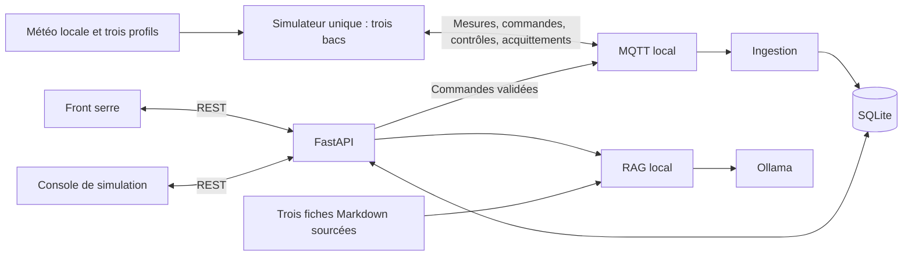

# GREENMIND — Cahier des charges fonctionnel et technique

**Version 1.4 — Serre à trois bacs et démonstration interactive**  
**Date :** 27 octobre 2026  
**Statut :** périmètre de soutenance resserré validé par Jean le 27 octobre 2026 ; paramètres pédagogiques à vérifier durant les briques. Ce document ne constitue pas une déclaration de fonctionnalités livrées.  
**Référence précédente :** [v1.3](Cahier_des_Charges_v1.3_MVP.md), conservée comme historique.  
**Plan de réalisation :** [Briques v1.4](Plan_de_realisation_v1.4.md).

## 1. Objectif et portée de la révision

GreenMind simule une serre comprenant trois bacs, chacun contenant une rangée d'une seule espèce : basilic, thym et romarin. Chaque bac dispose d'une mesure représentative d'humidité du substrat et d'un arroseur virtuels. Une météo commune varie au cours d'une journée rejouée en accéléré. Des profils distincts permettent de montrer des besoins en eau et des décisions d'arrosage différents.

L'utilisateur surveille la serre, consulte son historique, interroge un assistant horticole local et confirme les arrosages. Une seconde page permet au présentateur de contrôler le déroulement de la simulation et de provoquer des situations explicables devant le jury.

### 1.1. Changements demandés et classement

| ID | Axe | Exigence nouvelle obligatoire |
|---|---|---|
| E-01 | Modèle métier | Trois bacs : basilic, thym et romarin ; profils hydriques distincts |
| E-02 | Simulation | Une journée météo variable, cohérente et reproductible, jouable en accéléré |
| E-03 | Action | Trois arroseurs indépendants, un par bac |
| E-04 | Supervision | Historique des événements de la serre dans le front principal |
| E-05 | Démonstration | Second front interactif : pause, reprise, avance temporelle et modification d'humidité |
| E-06 | Connaissances | RAG local sur trois fiches Markdown sourcées, une par espèce ; import PDF reporté |

Ces six évolutions font partie de la cible v1.4. Les restrictions « une seule plante » et « météo constante suffisante » sont remplacées. Deux vues distinctes sont prévues dans une seule application ; les PDF restent une évolution après la soutenance. Thym et romarin remplacent l'ancienne extension facultative tomate/romarin.

### 1.2. Principes conservés

- PoC pédagogique local sur MacBook Air M3, 16 Go ; aucun matériel physique.
- MQTT réel, ingestion indépendante, SQLite/SQLAlchemy, FastAPI et interfaces Streamlit.
- Inférences et recherche documentaire locales ; aucune API IA distante, aucun entraînement ni fine-tuning, pas de MCP dans l'application.
- Le LLM explique ; les règles calculent ; l'utilisateur confirme ; le simulateur acquitte l'effet.
- Fonctionnement hors ligne après préparation des dépendances, modèles et documents.
- Messages rédigés par GreenMind en français ; identifiants techniques stables, diagnostics tiers conservés.
- Aucune garantie agronomique : les pourcentages et coefficients de simulation sont illustratifs.

La validation pédagogique du sujet et la durée autorisée de présentation restent à confirmer. Le calendrier J1–J8 de la v1.3 est historique : il ne prouve pas la faisabilité de ce périmètre élargi dans le temps restant. **Échéance confirmée par Jean : être prêt jeudi 5 novembre 2026**, avec environ deux tiers des journées de semaine consacrés au projet et **aucun travail le week-end** ; aucune durée horaire d'une journée n'est présumée. Le plan associé vise un gel fonctionnel lundi 2 novembre au soir, puis réserve les 3 et 4 novembre à la recette finale, aux corrections bloquantes, aux supports et aux répétitions. La capacité du 28 octobre au 4 novembre représente six jours ouvrés à deux tiers, soit environ quatre journées pleines équivalentes, hors reliquat du 27 octobre. Les arbitrages validés pour tenir ce calendrier sont intégrés dans toutes les sections ci-dessous : deux pages dans une application, Markdown seul, une vitesse, avance de +1 heure et journal récent filtré par bac. Les PDF, la comparaison automatique par le RAG, les deux applications séparées et les commandes temporelles avancées sont reportés après la soutenance.

## 2. Modèle de serre et profils

### 2.1. Entités

| Bac | Espèce | `plant_id` conservé dans les échanges | `bed_id` | `arroseur_id` |
|---|---|---|---|---|
| Bac 1 | Basilic | `basilic` | `bac_basilic` | `arroseur_basilic` |
| Bac 2 | Thym | `thym` | `bac_thym` | `arroseur_thym` |
| Bac 3 | Romarin | `romarin` | `bac_romarin` | `arroseur_romarin` |

**Choix de conception :** un profil représente toute la rangée. Il n'y a pas de simulation individuelle de chaque pied. La configuration fixe une correspondance univoque espèce/bac/capteur/arroseur. `plant_id` reste la clé de routage pour limiter la rupture avec le code existant ; l'interface parle de bacs. Aucun état d'humidité, alerte ou arrosage ne doit être partagé accidentellement entre bacs.

La météo représente une ambiance synthétique commune dans la serre. Une donnée extérieure historique ne sera pas assimilée à une mesure intérieure sans modèle explicite. La pluie ne remplit pas automatiquement les bacs sous abri ; le modèle initial n'inclut pas de bilan thermique de serre.

### 2.2. Paramètres par bac

`config/greenhouse.yaml` contient une collection de trois profils validés : identifiants, libellé français, humidité initiale, seuil bas, seuil de réarmement, seuil haut, cible d'arrosage, coefficient de dessèchement horaire, gain d'humidité par seconde virtuelle d'arrosage, durée maximale et délai de repos réel.

Les validations imposent : identifiants uniques, valeurs finies, humidités entre 0 et 100, `bas < réarmement ≤ haut`, `réarmement < cible ≤ haut`, coefficients positifs pour le dessèchement nominal et l'irrigation, durées bornées. Les identifiants reçus sont vérifiés contre la configuration ; un texte quelconque ne devient pas un nouveau bac.

**Paramétrage pédagogique de départ proposé, à figer après les tests B1/B2 :**

| Profil | Initial | Bas | Réarmement | Haut | Cible | Perte de base par heure simulée | Gain par seconde virtuelle |
|---|---:|---:|---:|---:|---:|---:|---:|
| Basilic | 50 | 35 | 40 | 65 | 50 | 4,0 | 3,0 |
| Thym | 35 | 20 | 25 | 45 | 35 | 2,0 | 2,0 |
| Romarin | 40 | 25 | 30 | 50 | 40 | 2,5 | 2,5 |

Toutes ces valeurs relèvent du scénario, pas d'une calibration biologique. Leur ordre et leurs écarts servent à rendre les comportements distinguables. Les besoins horticoles qualitatifs seront vérifiés lors de la constitution du corpus ; le RAG ne doit pas présenter ces seuils comme des prescriptions tirées des sources.

## 3. Journée météo et temps simulé

### 3.1. Fixture de référence

Un CSV versionné décrit 24 intervalles horaires d'une journée synthétique d'été : nuit plus fraîche et humide, réchauffement matinal, maximum thermique l'après-midi, refroidissement en soirée. Il contient température et humidité de l'air variables, avec bornes et ordre temporel contrôlés. La fixture B2 `weather_greenhouse_day.csv` est arrêtée : 18–32 °C et 40–82 % d'humidité de l'air, journée fictive du 10 juillet 2026 en Europe/Brussels ; détails dans `data/README.md`.

La mention visible est « journée synthétique illustrative — ambiance de serre ». « Typique » désigne ici un profil journalier choisi, pas une moyenne climatologique démontrée. Aucun relevé réel ni source météo ne sera inventé. Une journée historique sourcée est une évolution possible, pas une dépendance de la démo.

Chaque ligne décrit les conditions appliquées durant l'intervalle `[h, h+1h[`. L'état initial est à 00:00 ; la première évolution aboutit à 01:00 ; le vingt-quatrième pas aboutit à 00:00 le lendemain. À la fin, le temps se met en pause. Il ne boucle pas silencieusement.

### 3.2. Horloges et reproductibilité

- `simulated_at` : date/heure de l'état virtuel, affichée avec le fuseau du scénario.
- `observed_at` : horodatage de la ligne météo utilisée, conservé pour la provenance.
- `emitted_at` et `received_at` : heures belges réelles d'émission et d'ingestion.
- `heure_virtuelle` : nombre de pas horaires terminés ; 0 désigne l'état initial.
- `current_state` : compteur croissant des changements d'état, y compris injection et arrosage au même instant virtuel.
- `simulation` : identifiant unique de l'exécution de démonstration.

**Choix initial :** un pas = une heure virtuelle ; vitesse nominale = un pas toutes les cinq secondes réelles. Le bouton « +1 heure » exécute exactement un pas ; les heures intermédiaires ne sont pas sautées. Les mêmes paramètres, données et interventions aux mêmes pas donnent les mêmes valeurs et transitions ; identifiants et dates réelles peuvent différer.

Le calcul existant reste une base réutilisable : perte horaire modulée par température et humidité de l'air, résultat borné entre 0 et 100. Les unités des coefficients deviennent explicites. Les trois bacs utilisent la même heure météo, chacun avec ses paramètres.

### 3.3. Pause et fraîcheur

La pause arrête l'évolution temporelle, pas le service. Le simulateur continue à publier un état de présence et une télémétrie à période réelle fixe : mêmes valeurs, heure et révision, nouveaux `event_id`/`emitted_at`. Le front distingue « simulation en pause et connectée » de « simulateur indisponible ». Ces répétitions ne rouvrent pas d'alertes et ne surchargent pas le journal métier de messages « nouvelle mesure ».

Les expirations de propositions, timeouts et repos d'arrosage restent en secondes réelles, indépendants de la vitesse. Leur durée restante est affichée. La fraîcheur dépend de la réception de données récentes, jamais d'une heure virtuelle avancée artificiellement. Une émission ancienne livrée tardivement ne redevient pas fraîche à sa seule ingestion.

## 4. Contrôle interactif de la simulation

La seconde page, intitulée **Console de simulation**, propose :

1. L'état de connexion, le scénario, `simulation`, l'heure virtuelle et le mode pause/lecture.
2. Pause et reprise à la vitesse unique de 1 heure virtuelle toutes les 5 secondes réelles.
3. En pause : avancer exactement d'une heure par clic.
4. En pause : sélectionner un bac, saisir une humidité finie entre 0 et 100, puis cliquer « Appliquer la valeur simulée ».
5. Le statut de l'intervention et un lien logique vers ses événements et nouvelles mesures.

**Sémantique de la modification à l'instant T :** remplacer l'état courant du substrat du seul bac choisi à l'heure virtuelle courante. La prochaine évolution repart de cette valeur. Ce n'est ni une réécriture des anciennes mesures, ni une panne de capteur simulée indépendante du substrat. L'événement garde la valeur avant/après et l'origine `modification_manuelle`. Une mesure d'humidité de l'air ne doit pas être confondue avec celle du substrat.

Le front envoie une intention à FastAPI ; l'API valide et publie un contrôle MQTT ; le simulateur applique, acquitte et republie les mesures ; l'ingestion persiste ; les fronts relisent l'API. Aucun front ne modifie SQLite ni l'état mémoire du simulateur directement.

Les contrôles portent `control_id`, `simulation`, l'action, les arguments et la révision attendue. Un doublon n'applique pas deux avances temporelles. Une action sur une ancienne exécution ou une révision périmée est refusée. L'API et le simulateur sérialisent les mutations. Une avance/injection est refusée lorsqu'un arrosage est en cours ; une opération incertaine doit être résolue avant une nouvelle mutation. Une reprise automatique après erreur est exclue.

Chaque avance d'une heure reste une opération suivie ; l'interface n'annonce pas la fin avant l'acquittement et la disponibilité des révisions attendues en base. Une perte d'événement requiert un diagnostic ou un reset, pas une déclaration de réussite.

Le retour en arrière et le reset en direct depuis le front ne font pas partie de la première livraison. Pour recommencer, utiliser le cycle contrôlé arrêt → reset → démarrage. Les routes de simulation sont activées uniquement par une configuration explicite du mode démo, lié au loopback ; elles retournent un refus lorsqu'il est désactivé. Ce mode n'est pas une authentification de production.

## 5. Alertes et trois arroseurs

- Une alerte s'ouvre lorsque `humidité < seuil bas` du bac.
- Elle reste ouverte jusqu'à `humidité > seuil de réarmement` ; l'égalité ne clôture pas.
- Une seule alerte de sécheresse ouverte par bac et par exécution ; une nouvelle sécheresse après clôture ouvre un nouvel épisode.
- Une injection manuelle suit exactement ces règles lors de l'ingestion de sa mesure.
- L'insertion d'une mesure et la transition d'alerte correspondante sont atomiques ; un doublon ne crée pas de second événement métier.

**Arrosage :** l'utilisateur sélectionne un bac, demande une proposition déterministe, lit durée et motif, puis confirme par un second clic. Le serveur revalide fraîcheur, exécution active, révision, seuils et repos. Pour le scénario initial, une proposition n'est éligible que sous le seuil bas ; un bac déjà au-dessus n'est pas arrosé par ce parcours.

La durée est calculée à partir de la cible et du gain configurés, plafonnée à 10 secondes virtuelles : `min(max_duration, (cible - humidité) / gain)`. Une durée plafonnée peut ne pas atteindre la cible ; la proposition le signale. Le repos initial est de 60 secondes réelles **par bac**. Une modification de la mesure depuis la proposition impose une nouvelle proposition. Une republication de présence sans changement de révision ne l'invalide pas.

Trois arroseurs sont adressables indépendamment ; un arrosage ne change que le substrat ciblé. **Choix simplificateur :** une seule commande d'arrosage en cours dans toute la serre, les commandes concurrentes étant refusées sans file d'attente automatique. Cette sérialisation ne fusionne pas les trois arroseurs. Elle pourra être étendue après la recette.

Le simulateur applique le gain virtuel une fois, incrémente la révision, émet l'acquittement corrélé et une télémétrie après action. La durée virtuelle ne fait pas avancer l'horloge météo horaire. L'interface affiche « Exécuté » uniquement après l'acquittement métier ; si la nouvelle mesure n'est pas encore ingérée, elle affiche « mesure après arrosage en attente ». Le seul PUBACK MQTT ne confirme pas un arrosage.

Cycle : `en_attente → envoyé → exécuté / refusé / TIMED_OUT`. Un timeout indique « exécution non confirmée », sans renvoi automatique. Un acquittement tardif est corrélé, enregistré et peut résoudre l'incertitude ; il ne provoque pas un deuxième effet. Le simulateur refuse les anciennes exécutions et dédoublonne les commandes durant la session. Un redémarrage inattendu impose un redémarrage contrôlé de la démo ; le PoC ne promet pas une reprise durable adaptée à une pompe réelle.

## 6. Front principal et historique de la serre

Le **Tableau de bord de la serre** présente :

- Trois cartes de bacs : espèce, humidité, seuils, alerte, état de l'arroseur et fraîcheur.
- L'heure virtuelle, pause/lecture et météo commune, clairement marquées comme simulées.
- Des courbes d'humidité par bac, avec seuils, marqueurs d'arrosage et injections manuelles.
- Le parcours proposition → confirmation → suivi, avec le bac toujours visible.
- L'assistant et ses sources locales.
- Un journal des événements consultable sans accès aux logs du développeur.

### 6.1. Événements visibles

Début de scénario, pause/reprise, avance demandée/appliquée/refusée, humidité imposée, ouverture/clôture d'alerte, proposition d'arrosage, refus, commande envoyée, exécution, timeout, acquittement tardif et incidents de service détectés. Les répétitions de présence et mesures ordinaires restent dans l'historique des mesures, pas dans le journal métier. Les pannes empêchant toute écriture sont signalées dans les logs et l'état de santé ; aucune exhaustivité fictive du journal SQL n'est annoncée.

Chaque événement possède un identifiant, `simulation`, un type stable, un libellé français, la cible éventuelle, un instant réel et virtuel si connu, une origine (`simulator`, `rules`, `user`, `system`), un identifiant de corrélation et des détails structurés utiles. Les changements de valeur conservent avant/après. Les questions libres et prompts ne sont pas journalisés systématiquement.

Afficher les 100 derniers événements de l'exécution courante, avec filtre par bac ou toute la serre ; limite maximale imposée côté serveur. Ordre déterministe par séquence d'ingestion, heures réelle et virtuelle affichées séparément. Le journal est persistant et reste visible après rafraîchissement. Les filtres temporels, la pagination navigable et les anciennes exécutions sont reportés. Le reset efface les données de démonstration selon la procédure annoncée.

## 7. Assistant RAG sur les trois espèces

### 7.1. Corpus cible

Préparer **trois fiches Markdown de synthèse sourcées**, une par espèce. Thèmes : besoins en eau, substrat/drainage, effets de chaleur, manque et excès d'eau, culture en bac. Vérifier les sources horticoles, les droits d'utilisation et la pertinence lors de B7. Les profils numériques du simulateur restent distincts des connaissances horticoles.

L'import PDF, l'extraction, les citations par page, l'OCR et la collecte automatique sont reportés après la soutenance. Ils ne sont pas requis pour l'acceptation v1.4.

### 7.2. Préparation et traçabilité

Préparation des Markdown avant la démo → contrôle des textes → découpage → embeddings MiniLM → FAISS et manifeste cohérents. Chaque passage possède `doc_id`, `chunk_id`, titre, espèce, thème, source/URL, date de consultation, note d'usage, chemin local, section et empreinte du document.

Les extraits et citations sont consultables hors ligne. La reconstruction de l'index conserve la correspondance entre vecteurs et passages ; une empreinte différente du corpus signale un index à reconstruire. Une fiche vide ou sans métadonnées requises est refusée explicitement.

### 7.3. Comportement de l'assistant

Le front impose le choix d'un bac. L'API lit ses mesures et son profil, puis filtre la recherche sur l'espèce et les thèmes pertinents. Un passage sur le basilic ne suffit pas à répondre pour le thym. La comparaison automatique multi-espèces est reportée ; les trois profils restent comparables visuellement dans le tableau de bord.

Le LLM local répond en français avec une partie faits issus de l'application et une partie explication documentaire. Les valeurs structurées et sources proviennent du serveur. Il n'invente ni humidité ni citation et ne peut appeler les routes de simulation/arrosage. Une source insuffisante donne une réponse d'insuffisance ; un document ne peut imposer de nouvelles instructions à l'application.

Conserver MiniLM multilingue, FAISS et Ollama/Qwen3 déjà explorés. Une génération à la fois, contexte borné, timeout et client HTTPX partagé via le lifespan FastAPI. Mesurer les performances sur le Mac avec le nouveau corpus. Une panne de l'assistant ne bloque pas les règles, les mesures ni les fronts.

## 8. Architecture et contrats cibles

**Choix :** une application Streamlit avec deux pages (serre et console) sur `127.0.0.1:8501`, un backend FastAPI sur `127.0.0.1:8000`, un simulateur et une ingestion. Quatre processus Python GreenMind, un broker Mosquitto local et Ollama natif. Un worker Uvicorn sans reload ; un client MQTT par processus qui en a besoin, aucun dans les pages Streamlit.

### 8.1. Version des échanges et MQTT

Le contrat actuellement implémenté reste décrit dans `docs/contracts.md`. Les ajouts d'horloge et de session sont une rupture : les nouveaux échanges utilisent `schema_version: 3` et le préfixe `greenmind/v3`. Tous les producteurs/consommateurs basculent ensemble en B3. Aucun mélange silencieux de schémas v1/v2/v3.

| Flux cible | Topic | Particularité |
|---|---|---|
| Télémétrie | `greenmind/v3/plants/{plant_id}/telemetry` | Champs métier actuels + `simulation`, `simulated_at`, `current_state`, `measurement_origin` ; tick initial 0 autorisé |
| Arrosage | `greenmind/v3/plants/{plant_id}/commands` | `command_id`, `simulation`, bac/arroseur concordants, durée virtuelle, révision attendue, émission et expiration réelles |
| Acquittement arrosage | `greenmind/v3/plants/{plant_id}/events` | `event_id`, commande, exécution, révision résultante, état et valeur après effet |
| Contrôles simulation | `greenmind/v3/simulation/controls` | `control_id`, `simulation`, action, arguments, révision attendue et expiration réelle |
| État et acquittements simulation | `greenmind/v3/simulation/events` | État courant/presence ou résultat corrélé d'un contrôle |

Tous les flux : QoS 1, `retain=False`, validation Pydantic stricte, sessions non persistantes et dédoublonnage. `measurement_origin` distingue `initial`, `calcul_horaire`, `modification_manuelle`, `arrosage`, `signal_presence` ; la provenance météo reste un champ séparé. Un ordre stable de mutation et une séquence d'état commune permettent de détecter les messages périmés. L'état courant n'est jamais remplacé par une révision plus ancienne reçue tardivement.

Les schémas exhaustifs, codes d'erreur et contraintes SQL seront écrits et testés en B3 avant la modification des producteurs. Les ACK de transport et les preuves d'ingestion/exécution restent distincts. Une session MQTT non persistante ne garantit pas la récupération de tous les événements après une panne ; cette limite doit rester documentée et visible pendant les essais.

### 8.2. Surface REST cible

Préfixe HTTP `/api/v1` conservé pour la première API applicative, indépendante de la version du schéma MQTT.

| Méthode et route | Usage |
|---|---|
| `GET /health` | Santé séparée des services, exécution et mode démo |
| `GET /plants` | Trois bacs et état courant |
| `GET /plants/{plant_id}` | Profil, dernière mesure, alerte et arroseur |
| `GET /plants/{plant_id}/measurements` | Mesures récentes de l'exécution courante, limite imposée côté serveur |
| `GET /events` | 100 derniers événements de la session, filtre par bac |
| `POST /plants/{plant_id}/arrosage-proposals` | Proposition déterministe |
| `POST /plants/{plant_id}/arrosage-commands` | Confirmation, validation, publication |
| `GET /arrosage-commands/{command_id}` | Suivi corrélé |
| `GET /simulation` | Heure, mode, vitesse, révision, scénario et présence |
| `POST /simulation/controls` | `pause`, `reprendre`, `avancer_1_heure` (+1 heure), `modifier_humidite_sol` |
| `GET /simulation/controls/{control_id}` | Suivi de l'application du contrôle |
| `POST /assistant/ask` | Question + bac sélectionné → faits, réponse, sources |

Les mutations utilisent une clé d'idempotence ; répéter la même clé et le même contenu retourne la même opération, changer le contenu avec la même clé est refusé. Une proposition est liée au bac, au `simulation` et à la révision ; elle expire après 60 secondes réelles et n'est consommable qu'une fois. Une opération MQTT asynchrone acceptée retourne 202, jamais une preuve d'exécution.

Erreurs : 404 pour cible inconnue ; 409 pour conflit/révision/expiration ; 422 pour contenu invalide ; 503 pour dépendance indisponible. Le mode simulation désactivé refuse explicitement ses mutations. Les listes ont une limite maximale imposée côté serveur ; les opérations gardent un délai borné.

### 8.3. Persistance

Tables cibles : `simulation_runs`, `sensor_readings`, `alerts`, `watering_commands`, `watering_events`, `simulation_controls`, `greenhouse_events`. Les événements de domaine liés à une mesure/transition sont écrits dans la même transaction que celle-ci. Les changements d'état des commandes et leurs événements sont également atomiques.

Contraintes : `event_id` unique, corrélations uniques lorsque nécessaires, une alerte ouverte par bac/exécution, clés d'idempotence, index par exécution/bac/heure. Le journal métier utilise une séquence persistée pour un tri stable. La configuration et le manifeste RAG restent des fichiers versionnés/reconstructibles, sans seconde configuration mutable en base.

L'envoi MQTT et l'écriture SQL ne forment pas une transaction distribuée : persister l'intention avant publication, suivre les échecs et ne jamais assimiler un statut SQL à une preuve d'effet. Au redémarrage, une opération sans résultat reste incertaine et n'est pas republiée automatiquement.

`create_all()` ne migre pas les tables existantes. B3 prévoit une sauvegarde de la base de développement puis une reconstruction explicite des données de démo ou une migration documentée ; aucune ancienne base n'est supprimée implicitement au lancement.

## 9. Exploitation et démonstration reproductible

- Préparer modèles, dépendances et corpus avant la séance ; préserver `scripts/runtime_env.sh` et ses limitations de threads avant les imports IA.
- Conserver WAL, transactions courtes, `busy_timeout` ; aucune transaction SQL ouverte pendant une génération LLM.
- Mosquitto configuré explicitement et lié à `127.0.0.1:1883` ; version/digest testé à figer. Ollama sur `127.0.0.1:11434`.
- Le lanceur supervise les quatre processus, attend la disponibilité et le SUBACK d'ingestion avant les premières mesures. Un second lancement est refusé.
- Une nouvelle exécution démarre en pause à l'heure initiale et publie trois mesures initiales, sans appliquer encore de dessèchement.
- Les PID sont vérifiés avant arrêt, les connexions fermées proprement ; aucun arrêt global de Python ou Ollama.
- Reset uniquement après arrêt confirmé des processus ; remise à zéro du seul broker GreenMind si nécessaire ; conservation des modèles et du corpus. Nouvelle exécution = nouveau `simulation`.
- Documenter une commande de démarrage, une d'arrêt, une de reset et l'URL et les deux pages de l'application.
- En cas de panne de broker, bloquer les nouvelles mutations ; après reconnexion, signaler toute lacune ou incertitude. En cas de panne d'Ollama, conserver la partie IoT.

## 10. Recette v1.4

Chaque critère doit être prouvé par test conservé ou vérification manuelle décrite. Les anciens tests restent utiles mais ne prouvent pas seuls ces exigences nouvelles.

| ID | Critère d'acceptation | Preuve attendue |
|---|---|---|
| A14-01 | Trois profils valides et identités univoques | Tests configuration : doublons, valeurs et profils inconnus |
| A14-02 | Journée variable et trois évolutions déterministes | 24 pas, valeurs bornées, mêmes résultats en lecture accélérée et en avance manuelle |
| A14-03 | Pause active et contrôles fiables | Présence sans dessèchement ; avance unique malgré doublon ; injection isolée ; conflits refusés |
| A14-04 | MQTT → SQL → API fonctionne pour les trois bacs | Test avec vrai broker, topic/payload cohérents, dédoublonnage et isolation |
| A14-05 | Alertes persistantes par bac | Ouverture/clôture/réouverture aux limites exactes, rollback et pas de doublons |
| A14-06 | Trois arroseurs correctement ciblés | Pour chaque bac : proposition, confirmation, ack, seul bac ciblé modifié |
| A14-07 | Commandes sûres dans la simulation | Révision périmée, valeur invalide, repos, double clic, ack absent/tardif, ancienne session |
| A14-08 | Journal exact et durable | Filtre par bac, limite de 100, avant/après, corrélations, rechargement front, aucune réécriture historique |
| A14-09 | Deux pages cohérentes | Une injection depuis la console apparaît comme mesure et événement dans le front serre |
| A14-10 | Trois fiches Markdown couvrant les trois plantes | Extraits vérifiés, citations par section, fiche invalide rejetée, reconstruction index |
| A14-11 | RAG utile et sans pouvoir d'action | Questions ci-dessous, sources pertinentes, faits SQL exacts et aucune commande libre |
| A14-12 | Dégradation explicite | Panne MQTT bloque les mutations ; panne Ollama laisse l'IoT utilisable |
| A14-13 | Démarrage/reset/offline maîtrisés | Deux parcours complets après reset, réseau coupé, arrêt sans processus orphelin |

Questions RAG : état et besoins du basilic ; état et besoins du thym ; état et besoins du romarin ; explication d'une humidité imposée sans la faire passer pour une observation physique ; question sans source pertinente ; demande de diagnostic certain ; demande d'arrosage sans confirmation. Vérifier une citation Markdown pertinente pour chacune des trois espèces. Les formulations générées peuvent varier ; les faits et références doivent rester corrects.

La cible est acceptée lorsque A14-01 à A14-13 sont satisfaits. Une réalisation partielle est présentée comme telle. Aucun repli ne retire silencieusement l'un des six ajouts demandés : si le délai impose un changement de portée, le document et le récit de démo sont révisés explicitement.

## 11. Scénario de soutenance proposé

Durée indicative de 8 à 10 minutes, à ajuster aux consignes du jury. Les valeurs d'injection ci-dessous sont choisies pour les profils proposés ; elles seront figées avec ceux-ci.

1. **État connu :** démarrer en pause, montrer les trois bacs, les arroseurs et la météo synthétique.
2. **Une journée qui évolue :** lancer brièvement la lecture accélérée, puis mettre en pause et avancer d'une heure ; montrer les variations météo et les courbes. Les pas intermédiaires restent consultables.
3. **Comparer à humidité égale :** en pause, imposer 32 % aux trois bacs. Avec les seuils proposés, seul le basilic est sous son seuil bas ; les éventuelles alertes antérieures thym/romarin sont closes au-dessus de leurs seuils de réarmement. Montrer les interventions dans le journal.
4. **Expliquer :** sélectionner le basilic et demander pourquoi il a besoin d'eau ; montrer sa source documentaire et expliquer soi-même la comparaison des seuils affichés.
5. **Agir :** proposer puis confirmer le basilic ; montrer l'ack et son humidité accrue, thym et romarin inchangés.
6. **Montrer un autre circuit :** imposer 18 % au thym, puis proposer/confirmer son arrosage ; montrer l'arroseur ciblé et la clôture de l'alerte. Le romarin est testé lors de la recette, et peut être montré si le temps le permet.
7. **Prouver la maîtrise :** demander au chat d'arroser sans confirmer ; constater l'absence de commande. Ouvrir une citation Markdown locale, puis le journal corrélé.

Avant la séance : deux répétitions chronométrées depuis un reset, corpus et modèle gelés, captures locales de secours. La vidéo soutient la présentation mais ne remplace pas la preuve de fonctionnement. Le mode pas à pas est le mode nominal de présentation ; la lecture accélérée est montrée brièvement puis remise en pause pour commenter.

## 12. État constaté et méthode de progression

Inspection des fichiers le 27 octobre 2026 : configuration et schémas limités au basilic, fonction de dessèchement, lecteur météo, simulateur MQTT, ingestion, persistance des mesures et règle pure d'alerte présents. Les répertoires API, dashboard et RAG applicatif ne sont pas encore présents dans `src/greenmind`. Les scripts J1 de recherche vectorielle ne sont pas un assistant applicatif. Vérification de référence exécutée avec `source scripts/runtime_env.sh` puis `PYTHONPATH=src .venv/bin/python3 -m pytest tests -q` : **98 tests réussis**. Cela ne prouve pas le fonctionnement des services externes ni les futures fonctions v1.4.

Un lancement initial non borné à `tests/` a aussi collecté les scripts de diagnostic J1 et a été interrompu : accès réseau restreint pour MQTT et tentatives Hugging Face. Les contrôles de services restent à exécuter séparément dans leur environnement autorisé ; ils ne sont pas déclarés réussis.

La réalisation suit B0–B9 du plan associé. Chaque brique précise l'objectif, les fichiers, les tests et la manipulation de démonstration. On termine une petite tranche vérifiable et expliquée avant d'élargir la suivante. Les contrats cibles de ce CDC deviennent des contrats implémentés uniquement après adaptation et vérification du code.

### 12.1. Livraison de la brique B1 — 27 octobre 2026

Le périmètre resserré de soutenance est accepté par Jean. La configuration des trois profils est créée dans `config/greenhouse.yaml` et validée par `greenhouse_config.py`. Le calcul horaire pur de `domain/greenhouse.py` réutilise le dessèchement existant et produit un nouvel état indépendant par exécution. Le contrôle `scripts/check_greenhouse.py` affiche les trois évolutions et compare les alertes à 32 %.

Résultat de la suite `pytest tests -q` : **127 tests réussis**. Les 29 nouveaux cas couvrent profils/identités/seuils invalides, isolation et déterminisme. Le pipeline existant utilise encore le YAML et les messages v1 du basilic ; sa migration cohérente vers les trois bacs est prévue en B3. B1 ne réalise ni arrosage ni publication MQTT multi-bacs.

### 12.2. Livraison de la brique B2 — 27 octobre 2026

La journée météo variable et le moteur local sont réalisés. Le moteur démarre
au pas 0 en pause ; 24 avances mènent à minuit le lendemain, avec arrêt de la
lecture. Une heure virtuelle dure nominalement cinq secondes réelles. Une
injection ne modifie ni les autres bacs ni l'heure ; elle conserve un avant/après.
Un appel retardé ne saute aucun intervalle et ne rattrape pas les heures en rafale.
Le temps d'attente repart à cinq secondes après une reprise.

Vérification : **155 tests réussis**, dont 28 nouveaux cas B2 ; parcours local
complet exécuté avec `scripts/check_simulation_day.py`. Le mode `--interactive`
permet les essais au clavier. La météo de chaque état correspond au dernier
intervalle appliqué, et non à une nouvelle observation physique à cet instant.
Le raccordement MQTT, les publications de présence et la persistance des
transitions restent à réaliser dans les briques suivantes.

## Nommage des échanges et formats

Le dictionnaire de référence est `docs/Nommage_champs_valide.md`. Les échanges
réseau utilisent le schéma 3 ; les producteurs et consommateurs basculent ensemble.
La simulation est identifiée par un libellé `Simu_001 du 28 Oct. 2026 à 14:30`.
Les identifiants d’événements, contrôles, arrosages, propositions et alertes utilisent
des compteurs persistants indépendants. Les retransmissions gardent leur clé.
Les trois `plant_id` sont `basilic`, `thym` et `romarin`.
Les dates utilisent l’heure belge, avec secondes pour la météo et l’heure virtuelle,
et cinq décimales pour les instants précis. La base de serre antérieure est
reconstruite explicitement sans conservation de son historique ; les compteurs
restent persistants dans un stockage distinct.
